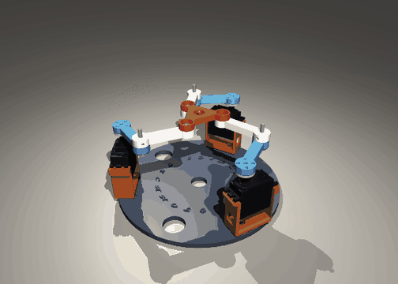
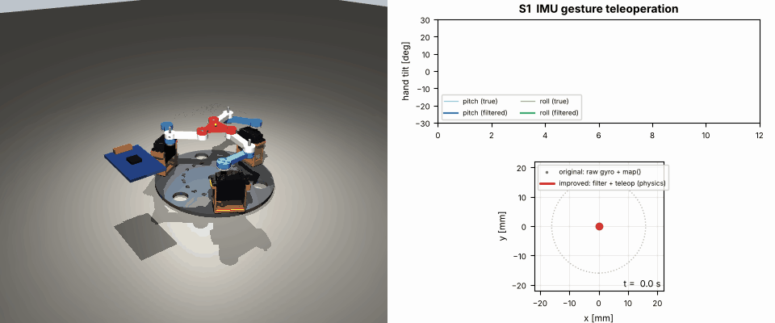
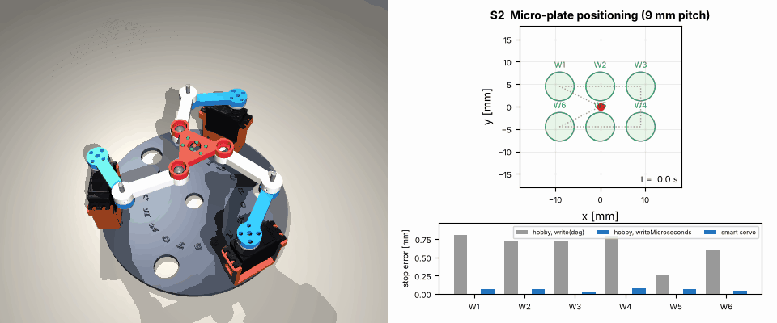
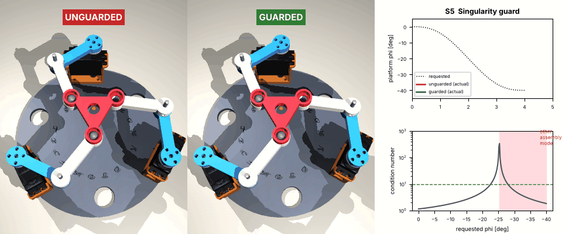
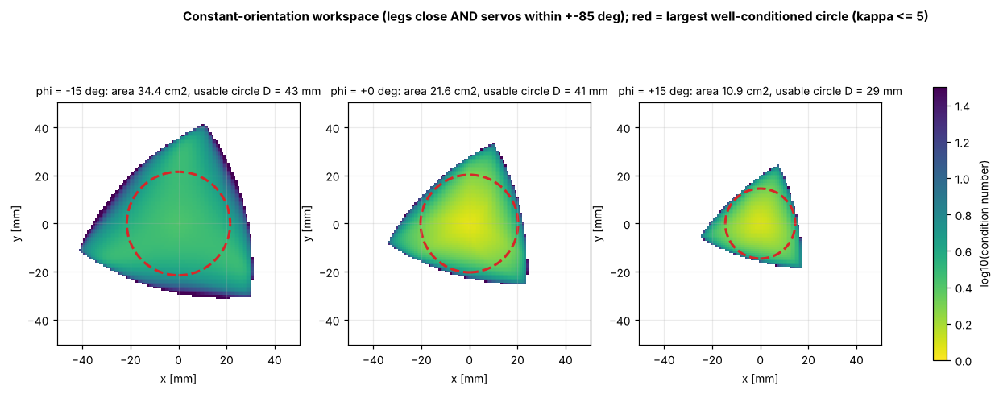
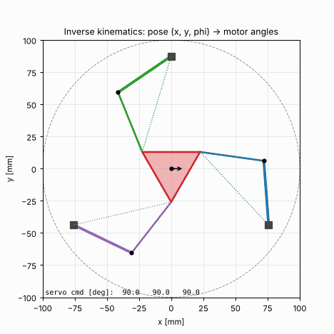

# 3-RRR Parallel Manipulator with IMU Control

**A complete, open robotics project: from a SolidWorks design to a validated ROS 2 robot, with a full course and industrial scenarios.**

[](https://github.com/basheeraltawil/parallel-manipulator-imu-control/actions/workflows/python.yml)
[](https://github.com/basheeraltawil/parallel-manipulator-imu-control/actions/workflows/ros2.yml)
  

<p align="center"></p>

A planar **3-RRR parallel robot**: three servo-driven legs move a triangular platform in **x, y and rotation**, steered by an **MPU6050 IMU** or by ROS 2. It started as a Master's project in Robotic Engineering (İzmir Katip Çelebi University, 2020) and has been restructured into:

* 🧮 **`pm3rrr_core`**: tested Python library for kinematics, singularities, workspace, dynamics, trajectories and IMU fusion
* 🛠️ **CAD → URDF pipeline**: meshes, inertia, SRDF and validation generated from the original SolidWorks parts
* 🤖 **ROS 2 Humble**: RViz kinematic sim, **Gazebo** physics with closed loops and `ros2_control`, real hardware bridge
* 🎬 **Physics scenarios** solving real problems (MuJoCo, same URDF), with a realistic hobby-servo model
* 📚 **12 lessons** with figures and exercises, for students and instructors
* 🏭 **Industrialization guide**: BOM tiers, wiring, firmware protocol, calibration, ISO 9283 testing, safety
* ⚙️ **New Arduino firmware**: IK + singularity guard, sensor fusion, watchdog, unit-tested against Python

---

## Scenarios: real problems, simulated with physics

| | |
|---|---|
| **S1 · Gesture teleoperation**: tilt a hand-held IMU to steer the stage. The original pipeline (gyro *rate* → position) barely moved (0.5 mm) when the hand was held tilted; the new fusion + teleop pipeline follows the tilt (15.4 mm) with zero jitter at rest. [→ details](docs/scenarios/s1_imu_teleoperation.md) |  |
| **S2 · Micro-plate positioning**: stop over 9 mm-pitch wells. Accuracy is set by the actuator: hobby servo 0.66 mm → `writeMicroseconds` 0.56 mm → **smart servo 0.06 mm**. [→ details](docs/scenarios/s2_precision_pick_place.md) |  |
| **S3 · Glue dispensing along a contour**: constant feed rate around a part; the error-vs-speed sweep selects **40 mm/s** for ±0.5 mm. [→ details](docs/scenarios/s3_contour_dispensing.md) |  |
| **S4 · Base-motion compensation**: a base gyro keeps the tool on a world-fixed target while the base yaws ±12°: error 0.85 → **0.20 mm**, 6.8° → **1.0°**. [→ details](docs/scenarios/s4_base_motion_compensation.md) |  |
| **S5 · Singularity guard**: "rotate by 40°" crosses a parallel singularity. Unguarded, the motors look right but the platform is **27° off**; the guard stops safely with a clear fault. [→ details](docs/scenarios/s5_singularity_guard.md) |  |

Short videos (MP4) are in [`docs/media/videos`](docs/media/videos). Regenerate everything with `python3 simulation/run_all.py`.

---

## Quick start

### 1. Simulation without ROS (any OS, 2 minutes)

```bash
git clone https://github.com/basheeraltawil/parallel-manipulator-imu-control.git
cd parallel-manipulator-imu-control
pip install -r requirements.txt
python3 simulation/scenarios/s5_singularity_guard.py     # physics + GIF in docs/media
python3 analysis/generate_figures.py                     # all lesson figures
python3 -m pytest ros2_ws/src/pm3rrr_core/test           # 23 tests of the maths
```

### 2. ROS 2 Humble: RViz and Gazebo (Ubuntu 22.04)

```bash
sudo apt install ros-humble-desktop ros-humble-xacro ros-humble-gazebo-ros-pkgs \
  ros-humble-gazebo-ros2-control ros-humble-ros2-controllers python3-serial
cd ros2_ws && rosdep install --from-paths src -y --ignore-src
colcon build --symlink-install && source install/setup.bash

ros2 launch pm3rrr_bringup sim_rviz.launch.py scenario:=figure8        # kinematic sim in RViz
ros2 launch pm3rrr_bringup sim_gazebo.launch.py scenario:=microplate   # physics in Gazebo
ros2 launch pm3rrr_bringup sim_rviz.launch.py scenario:=imu            # simulated hand IMU
ros2 topic pub -1 /pm3rrr/target_pose geometry_msgs/msg/Pose2D "{x: 0.01, y: 0.0, theta: 0.1}"
```

Scenarios: `figure8 · microplate · contour · rotation_limit · imu · none`.

### 3. Real robot (Arduino + 3× MG996R + MPU6050)

```bash
make -C firmware/test                                            # firmware logic vs. Python
arduino-cli upload --fqbn arduino:avr:uno -p /dev/ttyUSB0 firmware/pm3rrr_firmware
ros2 launch pm3rrr_bringup hardware.launch.py port:=/dev/ttyUSB0 scenario:=imu
```

Without a PC the firmware runs the IMU teleoperation stand-alone. Read the [commissioning procedure](docs/industrialization/05_calibration_and_commissioning.md) and the [safety chapter](docs/industrialization/07_safety_and_compliance.md) before powering the servos.

---

## The robot

| | |
|---|---|
| Kinematics | planar 3-<u>R</u>RR, 3 DOF (x, y, φ), closed-form IK, up to 6 FK solutions |
| Geometry (from CAD) | base Ø175 mm (servo axes), platform Ø52 mm (joints), links 50 + 50 mm |
| Usable workspace | Ø 41 mm circle at φ = 0 (κ ≤ 5); rotation −22° … +51° in the centre |
| Actuators | 3× TowerPro MG996R (1.08 N m, 0.14 s/60°); upgrade path: smart servos |
| Sensors | MPU6050 hand-held controller (0x68), optional base/platform IMU (0x69) |
| Controller | Arduino Uno/Nano firmware (19 kB) and/or ROS 2 Humble on a PC |

<p align="center"> </p>

## Learning resources

| Lesson | Topic |
|---|---|
| [00](docs/learning/00_learning_path.md) | learning path, notation |
| [01](docs/learning/01_system_overview.md) · [02](docs/learning/02_geometry_and_parameters.md) | system overview, geometry from CAD |
| [03](docs/learning/03_cad_to_urdf.md) | **SolidWorks → URDF, meshes, inertia, SRDF, step by step** |
| [04](docs/learning/04_inverse_kinematics.md) · [05](docs/learning/05_forward_kinematics.md) | inverse kinematics (8 working modes) · forward kinematics (assembly modes) |
| [06](docs/learning/06_jacobian_singularities.md) · [07](docs/learning/07_workspace_analysis.md) | Jacobians and singularities · workspace analysis |
| [08](docs/learning/08_dynamics.md) · [09](docs/learning/09_trajectory_generation.md) | dynamics and actuator sizing · trajectory generation |
| [10](docs/learning/10_imu_sensor_fusion.md) · [11](docs/learning/11_control_and_actuators.md) | IMU sensor fusion · actuators, accuracy and control |
| [12](docs/learning/12_ros2_architecture.md) | ROS 2 / Gazebo / RViz architecture |

<p align="center"> </p>

**Industrialization:** [requirements](docs/industrialization/01_requirements_and_specs.md) · [BOM tiers](docs/industrialization/02_bill_of_materials.md) · [build and wiring](docs/industrialization/03_mechanical_and_electrical.md) · [firmware and protocol](docs/industrialization/04_firmware_and_protocol.md) · [calibration](docs/industrialization/05_calibration_and_commissioning.md) · [testing (ISO 9283)](docs/industrialization/06_testing_and_validation.md) · [safety and CE](docs/industrialization/07_safety_and_compliance.md) · [scaling](docs/industrialization/08_scaling_to_product.md)

---

## Repository structure

```
.
├── README.md                     you are here
├── CLAUDE.md, CLAUDE.local.md    project guide for Claude Code (AI pair-programming)
├── .claude/                      Claude Code settings, rules, commands, skills, agents, hooks
├── .mcp.json                     MCP servers (GitHub)
├── ros2_ws/src/
│   ├── pm3rrr_core/              ROS-free maths library (kinematics, dynamics, workspace, ...)
│   ├── pm3rrr_description/       URDF/xacro, meshes, SRDF, robot_params.yaml, RViz
│   ├── pm3rrr_control/           controller (+ singularity guard), scenarios, IMU teleop, serial bridge
│   ├── pm3rrr_gazebo/            Gazebo Classic world, ros2_control controllers
│   └── pm3rrr_bringup/           launch: sim_rviz, sim_gazebo, hardware
├── simulation/                   MuJoCo physics of the same URDF + 5 scenarios
├── analysis/                     figure generation for the lessons
├── tools/cad_to_urdf/            step1..4: measure → meshes/inertia → SRDF → validate
├── firmware/                     Arduino firmware, bring-up sketches, host unit tests
├── hardware/                     SolidWorks CAD, STL, vendor models, linkage sketches
├── docs/
│   ├── learning/                 12 lessons
│   ├── scenarios/                5 industrial scenarios
│   ├── industrialization/        8-chapter product guide
│   ├── legacy/                   original report and slides + errata
│   └── media/                    GIFs, videos, figures
└── legacy/                       original sketches/scripts + code review
```

## Validation status

| Check | Result |
|---|---|
| Core maths tests (IK/FK/Jacobian, energy balance of the dynamics, trajectories, IMU, servo) | 23 passed |
| URDF ↔ kinematics loop closure (200 random poses) | max gap 0.001 µm |
| Firmware C++ IK vs. Python (400 poses) | max difference 0.00016° |
| Firmware build for ATmega328P | 19.2 kB flash (58 %), 752 B RAM |
| ROS 2 packages: `colcon build` + `colcon test` in `ros:humble` | see the CI badge |

## What changed from the original project?

The original idea, maths and CAD are preserved. The [legacy review](legacy/README.md) documents every bug that was found and fixed (gyro rate used as position, 360° commands to 180° servos, uninitialised variables, a non-compiling sketch, a platform radius of 15 mm in the analysis vs. 26 mm in the CAD), and the [errata](docs/legacy/README.md) correct the report (eq. 4 sign, 8 rather than 9 working modes).

## Author and license

**Basheer Altawil**, robotics developer and educator · [@basheeraltawil](https://github.com/basheeraltawil)
Released under the [MIT License](LICENSE). Contributions welcome: see [`CLAUDE.md`](CLAUDE.md) for conventions.
