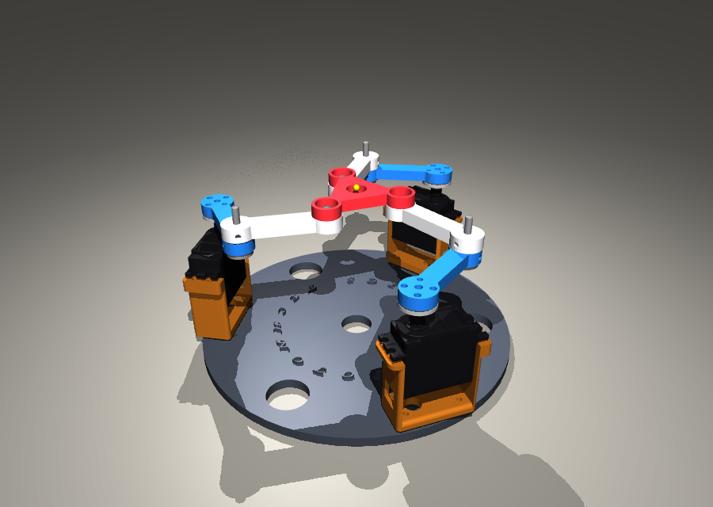
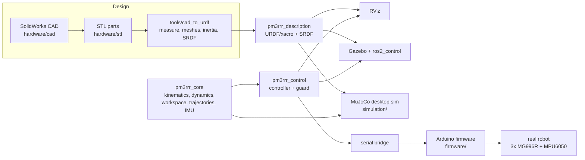

# 01 · System overview



## What is this robot?

A **planar 3-RRR parallel manipulator**: three identical legs connect a fixed base to a moving triangular platform. Each leg is a chain of three **R**evolute joints. The first one (underlined in the usual notation, <u>R</u>RR) is driven by a servo and the other two are passive.

```
   base ──[R motor]── proximal link ──[R elbow]── distal link ──[R platform]── platform
     (x3 legs, 120° apart, all closing on the same platform)
```

The platform moves in the plane: **3 degrees of freedom** (x, y, φ) driven by **3 motors**. Mobility check (Grübler–Kutzbach, planar):

$$ M = 3(n - 1) - 2 j = 3(8 - 1) - 2 \cdot 9 = 3 $$

(n = 8 bodies including the base, j = 9 revolute joints.)

## Why a *parallel* robot?

| | Serial arm (e.g. SCARA) | Parallel robot (this one) |
|---|---|---|
| Motors | carried by the next motor | all on the base: light, fast moving parts |
| Stiffness / precision | errors add up along the chain | the platform is held from 3 sides, so errors are averaged |
| Inverse kinematics | often hard | **easy** (closed form, lesson 04) |
| Forward kinematics | easy | **hard** (up to 6 solutions, lesson 05) |
| Workspace | large | small relative to the robot size (lesson 07) |
| Singularities | at the workspace boundary | **also inside** the workspace (lesson 06) |

Real uses of planar parallel mechanisms: precision XY-θ alignment stages (wafer, PCB, display and camera-module alignment), micro-manipulation, haptic devices, rehabilitation and training devices, and machine-tool fixtures. The [scenarios](../scenarios/README.md) model these jobs.

## The project in one picture



**One source of truth:** the geometry lives in `pm3rrr_description/config/robot_params.yaml`. The URDF, the Python library and the firmware's `config.h` all use it, and the tests fail if they disagree.

## The original project, and what changed

The original repository (kept in [`legacy/`](../../legacy/README.md)) contained the right idea: closed-form IK, an MPU6050 driving the platform, and a complete CAD design. The code, however, was experimental. The [legacy review](../legacy/README.md) lists every issue that was found and fixed. The most important ones:

* The report's equation (4), $h=\sqrt{L^2 + a^2}$, should read $\sqrt{L^2 - a^2}$, and the report counts "nine" working modes where there are $2^3 = 8$.
* The firmware fed the gyro **rate** into the platform position, so the platform moved only while the hand was rotating (scenario S1).
* Commands to 180° hobby servos went up to 360°, and `Servo.write(int)` gave 1° resolution (scenario S2).
* There was no reachability, servo-limit or singularity check, so the robot could be commanded into a parallel singularity (scenario S5).

## Exercises

1. Count the bodies and joints in the [render](../media/learning/robot_render.png) yourself and redo the mobility count.
2. If the platform joints were **prismatic** in the distal link direction (3-RRP), what would M be?
3. List two applications where the small workspace of a parallel robot does not matter and its precision does.
