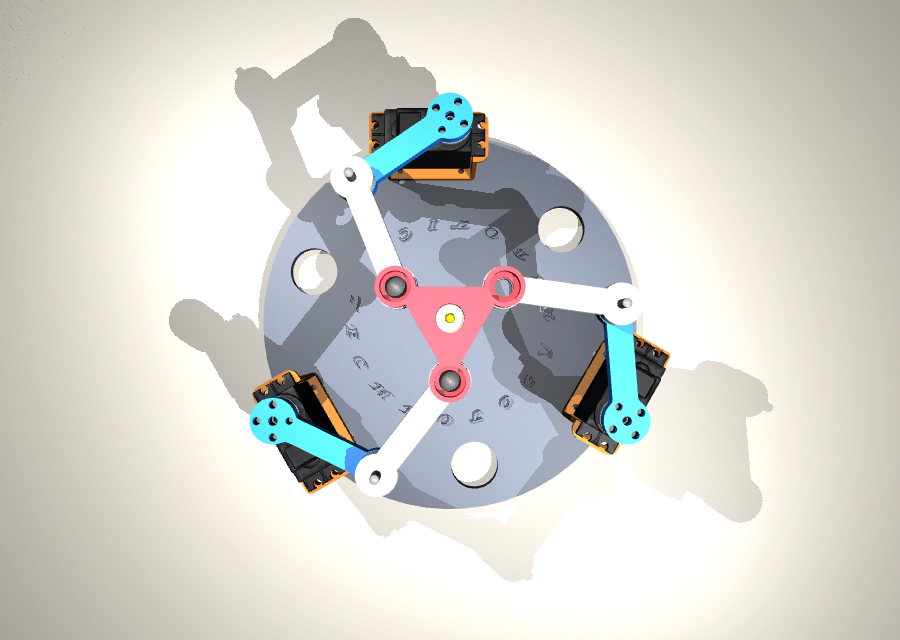
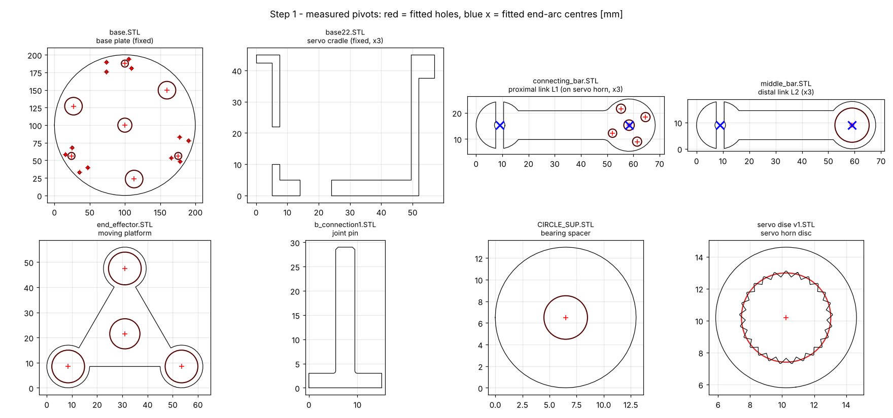

# 02 · Geometry and parameters



## Design parameters (measured from the CAD)

| Parameter | Symbol | Value | Where it comes from |
|---|---|---|---|
| Base radius (servo axes) | $R_b$ | 87.5 mm | `base.STL`: servo bores on a Ø175 mm circle |
| Base angles | $\lambda_i$ | −30°, 90°, 210° | the three bores, 120° apart |
| Platform radius (joints) | $r_p$ | 26 mm | `end_effector.STL`: bearing seats on a Ø52 mm circle |
| Platform angles | $\gamma_i$ | 30°, 150°, 270° | $\lambda_i + 60°$, as used in the original analysis code |
| Proximal link | $l_1$ | 50 mm nominal (49.35 mm measured!) | `connecting_bar.STL` horn spline → elbow |
| Distal link | $l_2$ | 50 mm | `middle_bar.STL` hole-to-hole |
| Working modes | $\sigma_i$ | −1, −1, −1 | $\theta = \beta - \alpha$, the branch used by the original code |
| Servo centre | $\theta_i^{home}$ | 94.29°, −145.71°, −25.71° | chosen = home-pose angles, so travel is symmetric |
| Servo travel | — | ±85° around centre | MG996R ±90°, minus a 5° safety margin |

The values are measured by [`step1_inspect_parts.py`](../../tools/cad_to_urdf/step1_inspect_parts.py) (lesson 03), not copied from drawings:



> **Engineering lesson: measure, don't assume.** The proximal link measures **49.35 mm** from the servo spline to the elbow, while the code assumed 50 mm. A 0.65 mm length error moves the platform by up to about 0.5 mm. Keep the nominal value in the model and *identify* the real lengths during calibration ([industrialization/05](../industrialization/05_calibration_and_commissioning.md)).

## Points and frames

* **World/base frame**: origin at the centre of the base plate, z up, robot moves in the xy-plane.
* $B_i = R_b(\cos\lambda_i, \sin\lambda_i)$: fixed motor axes.
* Platform frame: origin at the platform centre $\mathbf{p}=(x,y)$, rotated by $\varphi$.
* $C_i = \mathbf{p} + \mathbf{R}(\varphi)\,\mathbf{c}_i$, with $\mathbf{c}_i = r_p(\cos\gamma_i, \sin\gamma_i)$.
* $A_i = B_i + l_1(\cos\theta_i, \sin\theta_i)$.
* Constraint (one per leg): $\|C_i - A_i\| = l_2$.

Home pose $\mathbf{x}=(0,0,0)$, values computed by `pm3rrr_core`:

| Leg | $B_i$ [mm] | $\theta_i$ | $A_i$ [mm] | $C_i$ [mm] |
|---|---|---|---|---|
| 1 | (75.78, −43.75) | 94.29° | (72.04, 6.11) | (22.52, 13.00) |
| 2 | (0.00, 87.50) | −145.71° | (−41.31, 59.33) | (−22.52, 13.00) |
| 3 | (−75.78, −43.75) | −25.71° | (−30.73, −65.44) | (0.00, −26.00) |

The 120° symmetry is visible: $\theta_2 = \theta_1 + 120°$ and $\theta_3 = \theta_1 + 240°$ (mod 360°).

## Vertical stack-up (z)

The robot is planar, but its parts sit on different levels:

| Part | z range [mm] |
|---|---|
| Base plate | 0 – 8 |
| Servo cradles (3×) | 8 – 53 |
| MG996R body / spline top | 28 – 75.6 |
| Servo horn | 75.6 – 80.8 |
| Proximal links | 80.8 – 88.8 |
| Distal links | 88.8 – 96.8 |
| Platform | 96.8 – 103.8 |

Because the proximal links, distal links and platform each sit on their **own layer**, no two links can hit each other inside the workspace. This is proven by the collision sampling in lesson 03 (SRDF step), and it is a good design choice to reuse.

## Servo angle convention

A hobby servo takes 0–180° (pulse of 1000–2000 µs). The kinematics works with world angles θ. The mapping is:

$$ q_i = (\theta_i - \theta_i^{home})\,d_i, \qquad \text{servo}_i = 90° + q_i $$

with direction $d_i=\pm1$ depending on how the servo is mounted. In the URDF, the motor joint value **is** $q_i$, so 0 means the servo is at 90°, and $q_i=0$ for all joints is the home pose.

## Code

```python
from pm3rrr_core import Pm3rrrKinematics, RobotParams
p = RobotParams()                       # defaults = robot_params.yaml
print(p.base_points() * 1e3)            # B_i in mm
kin = Pm3rrrKinematics(p)
ik = kin.ik((0.0, 0.0, 0.0))
print(kin.joint_to_servo_deg(kin.motor_to_joint(ik.theta)))   # -> [90. 90. 90.]
```

## Exercises

1. Show that $\|C_i - B_i\|$ is the same for all three legs at the home pose. Why?
2. Change $\gamma_i$ to $\lambda_i$ (no 60° offset) and compute the home condition number (lesson 06). Which design is better conditioned?
3. With the measured $l_1 = 49.35$ mm, how far is the real platform from (0,0,0) when the servos are at 90°? (Hint: `RobotParams(l1=0.04935)` and `fk`.)
