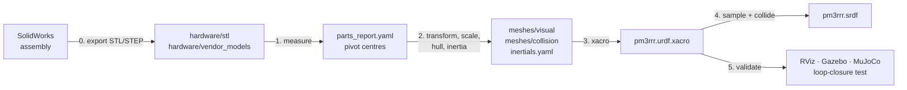
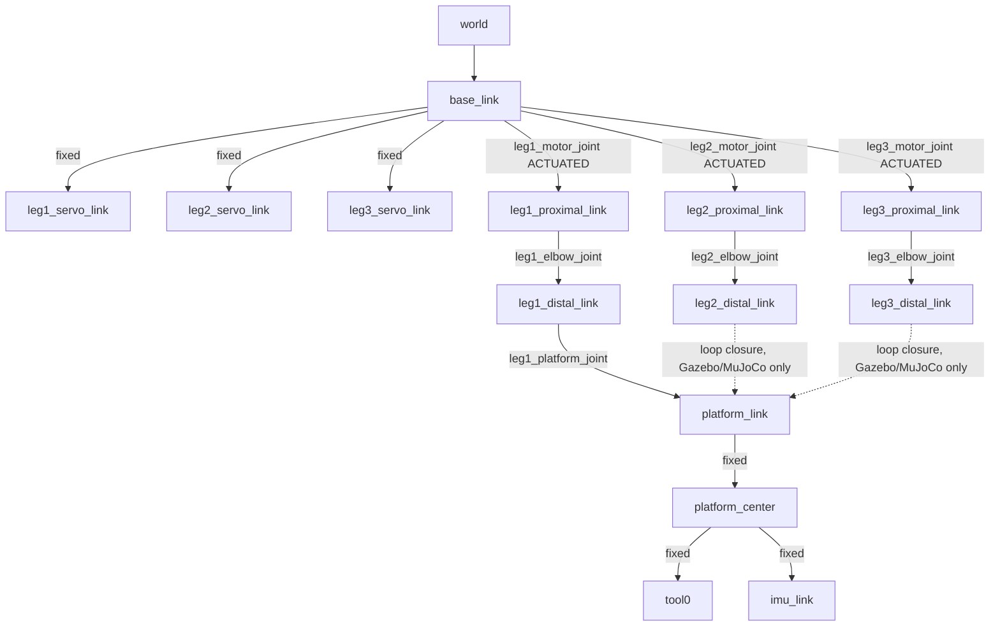

# 03 · From SolidWorks to URDF, meshes and SRDF, step by step

This lesson turns the original SolidWorks design ([`hardware/cad/solidworks`](../../hardware/cad/solidworks)) into a validated ROS 2 robot description ([`pm3rrr_description`](../../ros2_ws/src/pm3rrr_description)). Every step is a script you can rerun, so the model can always be regenerated when the CAD changes.




| Step | Script | Output |
|---|---|---|
| 0 | SolidWorks (manual) | STL per part (mm), STEP for vendor parts |
| 1 | [`step1_inspect_parts.py`](../../tools/cad_to_urdf/step1_inspect_parts.py) | pivot centres, sizes, volumes |
| 2 | [`step2_build_meshes.py`](../../tools/cad_to_urdf/step2_build_meshes.py) | meshes in link frames (m), convex collision hulls, `inertials.yaml` |
| 3 | [`urdf/*.xacro`](../../ros2_ws/src/pm3rrr_description/urdf) (hand-written, data-driven) | URDF, ros2_control and Gazebo extensions |
| 4 | [`step3_generate_srdf.py`](../../tools/cad_to_urdf/step3_generate_srdf.py) | `config/pm3rrr.srdf` |
| 5 | [`step4_validate_urdf.py`](../../tools/cad_to_urdf/step4_validate_urdf.py) | pass/fail report |

```bash
pip install -r requirements.txt
python3 tools/cad_to_urdf/step1_inspect_parts.py --plot /tmp/parts.png
python3 tools/cad_to_urdf/step2_build_meshes.py
python3 tools/cad_to_urdf/step3_generate_srdf.py
python3 tools/cad_to_urdf/step4_validate_urdf.py
```

---

## Two ways to get from CAD to URDF

| | **A. SolidWorks to URDF Exporter** (SW2URDF add-in) | **B. Scripted pipeline** (used here) |
|---|---|---|
| How | Click through the link tree inside SolidWorks | Export parts once, then Python scripts do the rest |
| Pros | Fast for a serial arm; inertia from SolidWorks materials | Reproducible, reviewable in git, no Windows/SolidWorks licence needed later, handles closed loops and 3D-printed density |
| Cons | Closed chains are not supported; generates a ROS 1 package; every CAD change means clicking through it again | You must understand frames (which is the point of this lesson) |

### Path A in brief (if you have SolidWorks)

1. Install the [SolidWorks to URDF Exporter](https://wiki.ros.org/sw_urdf_exporter).
2. In the assembly, add a **reference axis** on every joint axis (motor spline, elbow pin, platform bearing) and a **coordinate system** on every joint (z along the axis, x towards the next joint).
3. *Tools → Export as URDF.* Build the tree `base_link → leg_i_proximal → leg_i_distal`, and `leg1_distal → platform`. Pick the axis and coordinate system for each joint and set the types to *revolute*.
4. Set the materials (PLA ≈ 1240 kg/m³; then scale the density for infill, see step 2) and click *Export*.
5. Convert the generated ROS 1 package to ROS 2: `package.xml` format 3, `CMakeLists.txt` with `ament_cmake`, `package://` URIs unchanged.
6. **Add the loop closures by hand** (step 3). The exporter cannot express them.

The rest of this lesson follows **path B**. Its steps are the same as path A's, only explicit.

---

## Step 0: Prepare and export the CAD

Good habits in SolidWorks *before* exporting:

* **One part per rigid body.** Every part bolted to the same link (link + horn + screws) ends up in the same URDF link.
* **Origin and units.** Export **STL in millimetres**, binary, and *untick* "Do not translate STL output data to positive space". If the option is ticked, each part is shifted, which is what happened to the original parts (all bounds start at 0). Step 1 recovers the pivots anyway.
* **Vendor parts.** Download them as STEP (the MG996R in [`hardware/vendor_models/mg996r`](../../hardware/vendor_models/mg996r)). Step 2 converts STEP to a mesh with gmsh/OpenCASCADE.
* **Resolution.** "Fine" STL is enough for visuals; collision meshes are simplified later.

Parts used:

| Part file | Role | Qty |
|---|---|---|
| `base.STL` | base plate | 1 |
| `base22.STL` | servo cradle | 3 |
| `Servo MG996R.STEP` | servo body | 3 |
| `servo dise v1.STL` | servo horn disc | 3 |
| `connecting_bar.STL` | proximal link $l_1$ | 3 |
| `middle_bar.STL` | distal link $l_2$ | 3 |
| `b_connection1.STL` | elbow pin | 3 |
| `end_effector.STL` | platform | 1 |

## Step 1: Measure the parts

A URDF joint sits on an *axis*, so for every part we need the **pivot centres in the part's own coordinates**. `step1_inspect_parts.py`:

1. loads the STL and finds the thinnest axis (the plate normal);
2. slices the mesh at mid-thickness, which gives closed 2-D outlines;
3. fits a circle (algebraic least squares, Kåsa) to every inner loop to find the **holes**;
4. for elongated parts (links), fits circles to the **convex-hull** points at each end to find the **end-arc centres**. These are the pivots even when a clamp slot cuts the ring open.

$$ \min_{c_x,c_y,c}\ \sum_k \left(2c_x x_k + 2c_y y_k + c - (x_k^2 + y_k^2)\right)^2, \qquad r = \sqrt{c + c_x^2 + c_y^2} $$


Results (mm):

| Part | Measured | Meaning |
|---|---|---|
| base plate | 3 bores r = 5 at 87.5 mm from the centre, at 90°, −30°, 210° | $R_b$, $\lambda_i$ |
| platform | 3 seats r = 6.5 (Ø13, 624ZZ bearing) at 25.98 mm from the centre | $r_p$ |
| distal link | end arcs at (9, 9) and (59, 9): **50.00 mm** | $l_2$ |
| proximal link | horn hub (58.35, 15.29), elbow (9.0, 15.29): **49.35 mm** | $l_1$ (nominal 50) |
| MG996R | spline at x = 10 mm from the body end, flange underside 25 mm, spline top 47.6 mm | stack-up |

## Step 2: Put every mesh in its link frame

### 2.1 Choose the link frames (the most important decision)

Use one rule for every link: **origin on the joint axis that connects the link to its parent, z along that axis, x pointing to the next joint.** With this rule, the joint origins become trivial (`xyz="l 0 h"`).

| Link | Origin | x-axis towards | Mesh transform (mm) |
|---|---|---|---|
| `base_link` | base centre, table level | — | translate (−100, −100, 0) |
| `leg_i_servo_link` | motor axis $B_i$, table level | tangent (servo body side) | cradle: translate (−18.35, −12, 8); servo: y-up→z-up rotation, shaft to origin |
| `leg_i_proximal_link` | motor axis, top of horn (z = 80.8) | elbow | **rotate 180°** about z, then translate (−58.35, −15.29, 0) |
| `leg_i_distal_link` | elbow axis | platform joint | translate (−9, −9, 0) |
| `platform_link` | platform joint $C_1$, platform orientation | — | mesh in centre frame: rotate +60°, translate (−31, −21.49, 0); visual origin = $-\mathbf{c}_1$ |

Why rotate the proximal link by 180°? In its STL, the horn hub is at the **right**, but the link frame must point from the motor towards the elbow. Why rotate the platform by +60°? Its STL has the seats at −30°, 90°, 210°, while the design uses $\gamma_i = \lambda_i + 60°$.

### 2.2 Units

ROS uses SI units ([REP 103](https://www.ros.org/reps/rep-0103.html)). The script scales every mesh by 0.001 so that the URDF needs **no** `scale="0.001 0.001 0.001"` attribute. That attribute is the classic cause of "my robot is 1000× too big".

### 2.3 Visual vs. collision meshes

* **Visual**: full detail (`meshes/visual/*.stl`, ~1.2 MB in total).
* **Collision**: the **convex hull** of each part (`meshes/collision/*.stl`, 160–540 triangles each). Physics engines and planners are much faster and more robust with convex shapes.

### 2.4 Mass properties: 3D-printed parts are not solid

CAD mass properties assume solid material. A PLA print with 3 perimeters and 25 % infill is about **60 % solid**, so the script uses an effective density $\rho_{eff} = 1240 \times 0.6 = 744\ \mathrm{kg/m^3}$ and adds the hardware as point masses (bearings, screws). The servo body uses the datasheet mass (55 g). For each body:

$$ m = \sum m_k, \quad \mathbf{c} = \frac{1}{m}\sum m_k \mathbf{c}_k, \quad
\mathbf{I}_{c} = \sum \left[\mathbf{I}_k + m_k\left(\|\mathbf{c}_k\|^2\mathbf{1} - \mathbf{c}_k\mathbf{c}_k^T\right)\right] - m\left(\|\mathbf{c}\|^2\mathbf{1} - \mathbf{c}\mathbf{c}^T\right) $$

(parallel-axis theorem: move every contribution to the link origin, add them up, then move the sum to the combined centre of mass).

| Link | Mass | CoM along the link | $I_{zz}$ about CoM |
|---|---|---|---|
| proximal (+ horn) | 6.3 g | 17.9 mm | 2.77·10⁻⁶ kg m² |
| distal (+ pin, bearing) | 8.0 g | 28.7 mm | 3.89·10⁻⁶ kg m² |
| platform (+ 3 screws) | 11.2 g | centre | 5.89·10⁻⁶ kg m² |
| servo + cradle | 62.5 g | — | — |

The numbers go to [`config/inertials.yaml`](../../ros2_ws/src/pm3rrr_description/config/inertials.yaml), which the xacro reads. **No number is copied by hand.**

## Step 3: Write the xacro (URDF)

### 3.1 A closed chain in a tree format

URDF describes **trees**: every link has exactly one parent. Our robot has two closed loops, so we:

1. model a **tree** that reaches every link once, and
2. add the two missing joints as **loop closures** that only physics engines read.



RViz still draws a closed robot, because the controller publishes values for every tree joint computed by the inverse kinematics (lesson 04). Legs 2 and 3 then end exactly on the platform. The validation step checks this.

### 3.2 Data-driven xacro

[`pm3rrr_macros.xacro`](../../ros2_ws/src/pm3rrr_description/urdf/pm3rrr_macros.xacro) loads both YAML files:

```xml
<xacro:property name="params" value="${xacro.load_yaml('$(find pm3rrr_description)/config/robot_params.yaml')['pm3rrr']}"/>
<xacro:property name="inertials" value="${xacro.load_yaml('$(find pm3rrr_description)/config/inertials.yaml')}"/>
```

One `pm_leg` macro, instantiated three times, builds a leg from its index: base angle, servo centre and so on.

### 3.3 Joint origins and the "zero = home" convention

```xml
<joint name="leg${idx}_motor_joint" type="revolute">
  <origin xyz="${bx} ${by} ${z_motor}" rpy="0 0 ${center}"/>        <!-- servo mounting angle -->
  <limit lower="${-servo_limit}" upper="${servo_limit}" effort="1.08" velocity="7.0"/>
</joint>
<joint name="leg${idx}_elbow_joint" type="revolute">
  <origin xyz="${l1} 0 ${link_t}" rpy="0 0 ${radians(elbow_home_deg)}"/>   <!-- elbow angle AT HOME -->
</joint>
```

The yaw of every joint origin is the joint's angle **at the home pose**. As a result, **all joint values = 0 is the assembled home pose**. This matters for physics: Gazebo spawns a model with all joints at 0, and if zero were not an assembled configuration, the loop-closure constraints would snap the robot together violently on start-up. `robot_params.yaml` stores these angles, and a unit test checks them against the IK.

Joint limits follow the physics:

* motor: ±85° (servo travel), effort = MG996R stall torque, velocity = no-load speed;
* elbow: 5°…175° absolute, so the leg never straightens (that would be a serial singularity, lesson 06).

### 3.4 Gazebo extension: the loop closures

A `<gazebo>` block **without** a `reference` attribute is copied verbatim into the SDF model, so we can add the joints URDF cannot express ([`pm3rrr.gazebo.xacro`](../../ros2_ws/src/pm3rrr_description/urdf/pm3rrr.gazebo.xacro)):

```xml
<gazebo>
  <joint name="leg2_platform_joint" type="revolute">
    <parent>leg2_distal_link</parent>
    <child>platform_link</child>
    <pose>${c2x - c1x} ${c2y - c1y} 0 0 0 0</pose>   <!-- expressed in the CHILD frame -->
    <axis><xyz>0 0 1</xyz></axis>
  </joint>
</gazebo>
```

### 3.5 ros2_control

[`pm3rrr.ros2_control.xacro`](../../ros2_ws/src/pm3rrr_description/urdf/pm3rrr.ros2_control.xacro) declares:

* motor joints with an **effort** command interface. The `joint_trajectory_controller`'s PD gains then play the role of the servo's internal position loop. A position interface would *teleport* the joints and break the closed loops.
* passive joints with **state interfaces only**, so `joint_state_broadcaster` publishes them and RViz can draw the robot from Gazebo data.

## Step 4: SRDF, the semantic description

The URDF says what the robot *is*; the SRDF ([`config/pm3rrr.srdf`](../../ros2_ws/src/pm3rrr_description/config/pm3rrr.srdf)) says how to *use* it:

* **Groups**: `platform_motors` (3 motor joints), `leg1..3` (chains), `platform`.
* **Named state**: `home` (all motor joints 0).
* **Passive joints**: the elbows and `leg1_platform_joint`. A planner must never try to drive them.
* **Self-collision matrix**: which link pairs never need checking.

The collision matrix is generated the way the MoveIt Setup Assistant does it, with one important change: a parallel robot's valid configurations lie **on the loop**, so we sample **platform poses** and use the IK. Sampling joint angles independently, as the assistant does, would produce impossible, broken-loop configurations.

```
3000 valid configurations sampled, 55 link pairs:
  Adjacent:  10 pairs disabled   (parent/child)
  Always  :   0 pairs disabled
  Never   :  45 pairs disabled   (never touched in 3000 poses)
  checked :   0 pairs stay enabled
```

All pairs are disabled because the **layered design** (lesson 02) makes self-collision impossible inside the workspace. The collision checker was itself tested: it detects a 4 mm overlap and correctly ignores a 0.1 mm gap.

> **MoveIt and closed chains.** MoveIt plans for serial chains. For this robot, use the SRDF for the collision matrix, named states and joint-space moves. Cartesian platform motions come from the analytic IK in `pm3rrr_core` (lesson 12).

## Step 5: Validate before you trust it

`step4_validate_urdf.py` must print `ALL CHECKS PASSED`:

1. xacro expands with and without the Gazebo/ros2_control options;
2. the URDF is a tree with exactly the 7 expected movable joints;
3. every mesh file exists, and every inertia is positive definite and satisfies the triangle inequality ($I_1 + I_2 \ge I_3$);
4. **loop closure**: for 200 random poses, the IK joint values go into the URDF, forward kinematics runs **through the tree**, and the distal ends of legs 2 and 3 must coincide with the platform seats. Result: max gap **0.001 µm**, and `platform_center` matches the commanded pose to 8·10⁻⁹. The URDF and the maths are proven consistent.

Then look at it:

```bash
ros2 launch pm3rrr_description display.launch.py     # RViz, static
ros2 launch pm3rrr_bringup sim_rviz.launch.py        # RViz, moving
ros2 launch pm3rrr_gazebo gazebo.launch.py           # Gazebo physics
python3 simulation/scenarios/s0_overview.py          # MuJoCo physics, same URDF
```

The MuJoCo model in [`simulation/pm3rrr_sim/mujoco_model.py`](../../simulation/pm3rrr_sim/mujoco_model.py) loads the same generated URDF and adds the loop closures as site-to-site `connect` equality constraints. It holds the loop to about 10⁻¹⁵ m, which independently confirms the frames.

## Common pitfalls (and how this pipeline avoids them)

| Symptom | Cause | Fix used here |
|---|---|---|
| Robot 1000× too big or invisible | mm meshes, m URDF | scale meshes once in step 2 |
| Parts offset or rotated | STL exported "in positive space"; wrong link frame | measure pivots (step 1), explicit transforms (step 2) |
| Robot explodes in Gazebo at start | loops not assembled at joint = 0 | "zero = home" joint origins |
| Gazebo robot jitters or teleports | position interface on a closed chain | effort interface + PID |
| Simulated robot far too heavy or light | solid-density inertia, hand-copied numbers | effective density + generated `inertials.yaml` |
| Planner reports collisions everywhere | no or a wrong collision matrix | loop-aware SRDF sampling |
| URDF and code disagree | geometry duplicated in 3 places | one YAML + unit tests |

## Exercises

1. Change `FILL_FACTOR` to 1.0 (solid parts), regenerate, and compare the peak torques of scenario S3.
2. Replace the MG996R with the MG90S vendor model (`hardware/vendor_models/mg90s/MG90S.STL`) in step 2. What has to change in the stack-up?
3. Export the URDF with `xacro ... > pm3rrr.urdf` and run `check_urdf`. Why does it not see legs 2 and 3 closing?
4. Make the collision meshes 5 mm thicker in z (scale the hulls). Which pairs does the SRDF step now keep enabled, and why?
