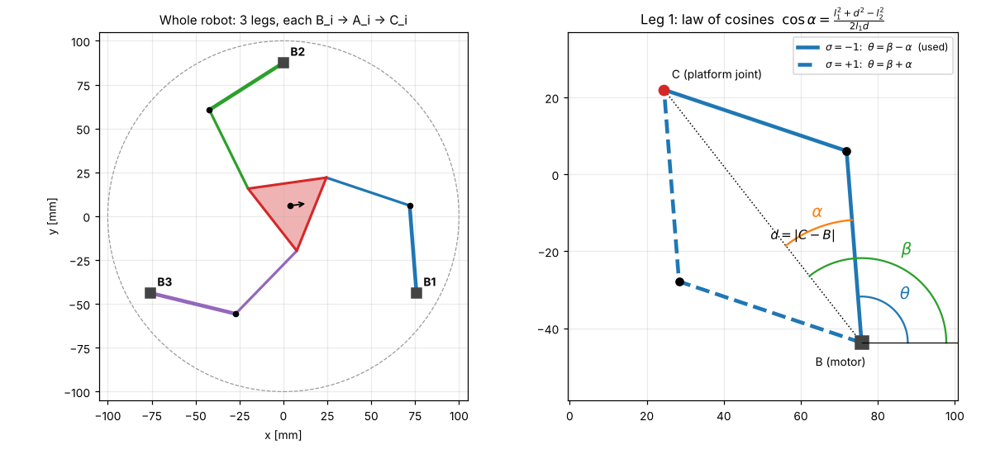
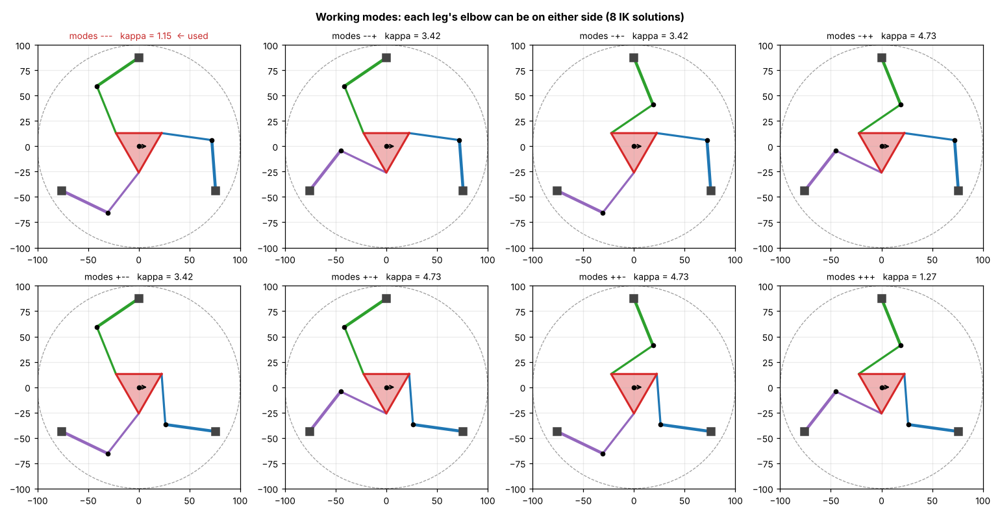

# 04 · Inverse kinematics (pose → motor angles)


## Problem

Given the desired platform pose $\mathbf{x}=(x, y, \varphi)$, find the three motor angles $\theta_i$.

For a parallel robot this is the **easy** direction: each leg can be solved independently, in closed form.

## Derivation (one leg)

1. Platform joint position: $C_i = \mathbf{p} + \mathbf{R}(\varphi)\mathbf{c}_i$, with $\mathbf{R}(\varphi)=\begin{pmatrix}\cos\varphi & -\sin\varphi\\ \sin\varphi & \cos\varphi\end{pmatrix}$.
2. Vector from the motor to the platform joint: $\mathbf{d}_i = C_i - B_i$, $d_i = \|\mathbf{d}_i\|$.
3. The leg forms the triangle $B_i A_i C_i$ with sides $l_1$, $l_2$, $d_i$:



$$ \beta_i = \operatorname{atan2}(d_{iy}, d_{ix}) \qquad\text{(direction of } B_iC_i\text{)} $$

$$ \cos\alpha_i = \frac{l_1^2 + d_i^2 - l_2^2}{2\,l_1\,d_i} \qquad\text{(law of cosines)} $$

$$ \boxed{\ \theta_i = \beta_i + \sigma_i\,\alpha_i\ }, \qquad \sigma_i = \pm 1 $$

4. Existence: the leg can close only if $|\cos\alpha_i| \le 1$, i.e. $|l_1 - l_2| \le d_i \le l_1 + l_2$. Outside this range the pose is **unreachable**.

### Link to the original report

With equal links $l_1 = l_2 = L$, the triangle is isosceles, so the foot of the height splits $d_i$ into two halves $a = d_i/2$:

$$ a = \frac{\sqrt{P_x^2 + P_y^2}}{2}, \qquad h = \sqrt{L^2 - a^2}, \qquad \alpha_i = \operatorname{atan2}(h, a), \qquad \theta_i = \beta_i \pm \alpha_i $$

These are exactly equations (1)–(7) of [the original report](../legacy/report.pdf), with one correction: the report prints $h=\sqrt{L^2 \mathbf{+} a^2}$, which must be a **minus** (Pythagoras in the right triangle with hypotenuse $L$). The unit test `test_report_equations_match_general_ik` checks that the report's formula, corrected, equals the general law-of-cosines solution.

## Working modes: 8 solutions, not 9

Each leg has two elbow solutions ($\sigma_i = \pm1$), so a reachable pose has $2^3 = \mathbf{8}$ IK solutions, called **working modes**. (The original report says "nine"; its own table lists eight rows.)



All 8 have the same *reachable* area here (each leg closes or not regardless of $\sigma_i$), but their **quality** differs a lot. At the home pose:

| Modes | κ (condition number) | Comment |
|---|---|---|
| − − − | **1.15** | used: nearly isotropic, matches the original code's $\theta=\beta-\alpha$ |
| + + + | 1.27 | also good, mirror-like |
| mixed | 3.4 – 4.7 | poorly conditioned, asymmetric |

Changing working mode means a leg passes through its **stretched or folded** configuration, a *serial* (Type-I) singularity. The robot never does this in operation; the mode is chosen once, at assembly.

## From world angles to servo commands

$$ q_i = \operatorname{wrap}\big((\theta_i - \theta_i^{home})\,d_i\big), \qquad \text{servo}_i[°] = 90 + \frac{180}{\pi}q_i, \qquad |q_i| \le 85° $$

The original code wrapped angles to 0…360° and sent them directly to `Servo.write()`, which only accepts 0…180°. The mapping above fixes this and adds the travel check.

## Algorithm (as implemented)

```python
def ik(pose, modes):
    C = p + R(phi) @ c_i                         # 3 platform joints
    d = C - B ; dist = |d|
    beta  = atan2(d_y, d_x)
    cos_a = (l1^2 + dist^2 - l2^2) / (2 l1 dist)
    reachable = all(|cos_a| <= 1)
    theta = wrap(beta + modes * acos(clip(cos_a)))
    q = wrap(theta - theta_home)                  # URDF joint, 0 = servo at 90 deg
    within_limits = all(|q| <= 85 deg)
```

The firmware's C++ version ([`kinematics.cpp`](../../firmware/pm3rrr_firmware/kinematics.cpp)) is tested against the Python one on 400 random poses: the largest difference is **0.00016°**.

## Try it

```python
import numpy as np
from pm3rrr_core import Pm3rrrKinematics
kin = Pm3rrrKinematics()
for pose in [(0, 0, 0), (0.01, -0.005, np.radians(5)), (0.06, 0, 0)]:
    r = kin.ik(pose)
    print(pose, r.ok, r.message, kin.joint_to_servo_deg(kin.motor_to_joint(r.theta)).round(2))
```

## Exercises

1. Prove that for $l_1 = l_2$, $\operatorname{atan2}(h, a) = \arccos\!\left(\frac{d}{2L}\right)$.
2. At which distance $d_i$ is $\partial\theta_i/\partial d_i$ infinite? What does the leg look like there?
3. Using `kin.ik(pose, modes=(1,1,1))`, plot the servo commands along a 20 mm circle for modes −−− and +++. Which mode uses less servo travel?
4. The original `parallel_inverse_kinematics.ino` called `tests.write(theta)` *before* computing `theta` in one branch. What did the servo receive on the first loop iteration? (Hint: uninitialised local `float`.)
