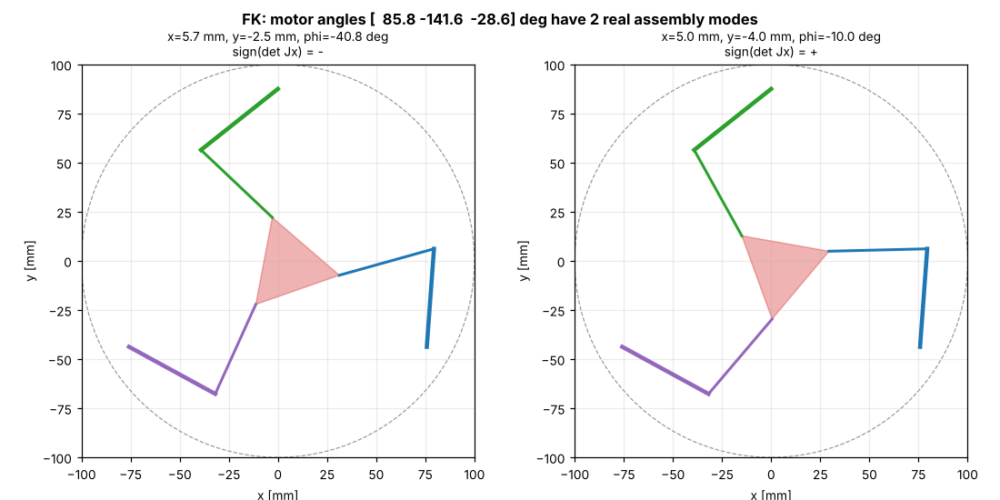

# 05 · Forward kinematics (motor angles → pose)

## Problem

Given the measured motor angles $\theta_i$, where is the platform? You need this to:

* show the *measured* robot pose (encoders, Gazebo joint states): node `fk_monitor`;
* compute tracking errors;
* understand **assembly modes** (scenario S5).

For a parallel robot this is the **hard** direction: the motor angles fix the elbows $A_i$, and the platform must satisfy three coupled constraints

$$ F_i(\mathbf{x}) = \big\|\mathbf{p} + \mathbf{R}(\varphi)\mathbf{c}_i - A_i\big\|^2 - l_2^2 = 0, \qquad i=1,2,3 $$

For the 3-RRR this system has **up to 6 real solutions**: it reduces to a polynomial of degree 6 in $\tan(\varphi/2)$.

## Method 1: all solutions by a 1-D search (`fk_all`)

1. For a trial orientation $\varphi$, constraint $i$ says $\mathbf{p}$ lies on a circle of radius $l_2$ centred at $K_i(\varphi) = A_i - \mathbf{R}(\varphi)\mathbf{c}_i$.
2. Intersect the circles of legs 1 and 2: this gives 0 or 2 candidate points $\mathbf{p}$.
3. Evaluate leg 3's residual $f(\varphi) = \|\mathbf{p} - K_3\| - l_2$.
4. Scan $\varphi \in [-\pi, \pi]$, find the sign changes of $f$, and refine each with Newton's method.

It is robust and visual, so it suits teaching and offline analysis.



Here, the same three motor angles give two poses: the intended one (φ = −10°) and a second one (φ = −40.8°). The sign of $\det \mathbf{J}_x$ (lesson 06) differs between them. They are separated by a parallel singularity.

## Method 2: Newton–Raphson in real time (`fk`)

At run time you always know the previous pose, which is an excellent initial guess:

$$ \mathbf{x}_{k+1} = \mathbf{x}_k - \mathbf{J}_F(\mathbf{x}_k)^{-1}\,\mathbf{F}(\mathbf{x}_k), \qquad
\mathbf{J}_F = 2\begin{pmatrix} u_{1x} & u_{1y} & \mathbf{u}_1\cdot\mathbf{E}\mathbf{R}\mathbf{c}_1\\ \vdots & & \end{pmatrix}, \quad \mathbf{u}_i = C_i - A_i,\ \mathbf{E}=\begin{pmatrix}0&-1\\1&0\end{pmatrix} $$

It converges quadratically, in 2–3 iterations to 10⁻¹² m, and **stays in the current assembly mode**. Note that $\mathbf{J}_F = 2\mathbf{J}_x$: the FK fails exactly at parallel singularities.

## Why this matters in practice

* With hobby servos there is **no position feedback**, so the controller only knows the *commanded* angles. In scenario S5, the servos reached the goal angles exactly while the platform sat in the *other* assembly mode, 27° away from the goal. Only an external sensor (camera, IMU on the platform, encoders on the passive joints) can detect that.
* A real product either guarantees by design that the robot never leaves its assembly mode (a singularity guard, lesson 06), or measures the platform directly.

## Try it

```python
import numpy as np
from pm3rrr_core import Pm3rrrKinematics
kin = Pm3rrrKinematics()
theta = kin.ik((0.005, -0.004, np.radians(-10))).theta
for s in kin.fk_all(theta):
    print(np.round(s[:2] * 1e3, 2), "mm", np.round(np.degrees(s[2]), 2), "deg")
print(kin.fk(theta, guess=(0, 0, 0)))       # Newton from home -> nearest solution
```

## Exercises

1. Find motor angles for which `fk_all` returns 4 or more solutions. (Hint: try poses near the edge of the workspace.)
2. Seed `fk` with a guess near the *other* solution of the figure. Which one does Newton converge to?
3. Time `fk` and `fk_all` with `%timeit`. Which one would you run at 500 Hz?
