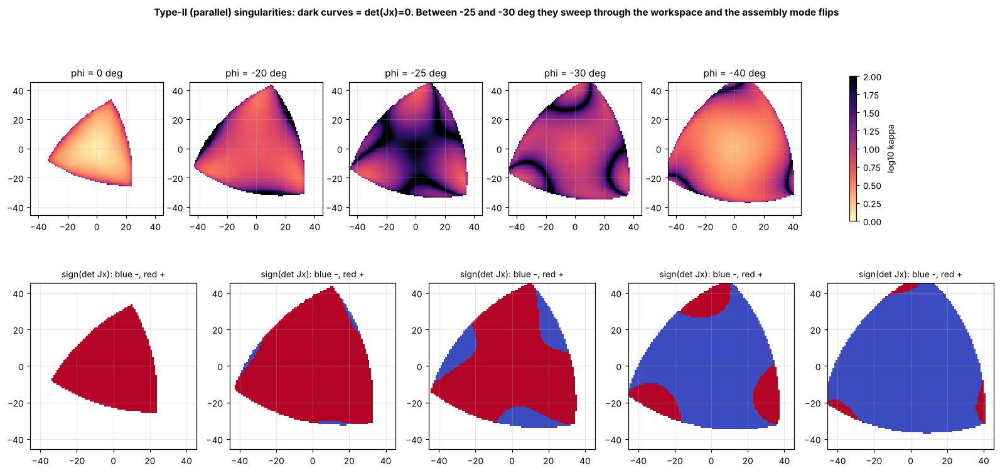

# 06 · Velocity kinematics, Jacobians and singularities

## Deriving the Jacobians

Differentiate the leg constraint $\|C_i - A_i\|^2 = l_2^2$ with respect to time. With $\mathbf{u}_i = C_i - A_i$ (the distal link vector) and $\mathbf{E}$ the 90° rotation matrix:

$$ \dot C_i = \dot{\mathbf{p}} + \dot\varphi\,\mathbf{E}\mathbf{R}\mathbf{c}_i, \qquad \dot A_i = \dot\theta_i\,\mathbf{E}(A_i - B_i) $$

$$ \mathbf{u}_i\cdot(\dot C_i - \dot A_i) = 0 \;\Rightarrow\; \underbrace{\begin{pmatrix} u_{ix} & u_{iy} & \mathbf{u}_i\cdot\mathbf{E}\mathbf{R}\mathbf{c}_i \end{pmatrix}}_{\text{row } i \text{ of } \mathbf{J}_x}\dot{\mathbf{x}} = \underbrace{\mathbf{u}_i\cdot\mathbf{E}(A_i - B_i)}_{(\mathbf{J}_q)_{ii}}\ \dot\theta_i $$

$$ \boxed{\ \mathbf{J}_x\,\dot{\mathbf{x}} = \mathbf{J}_q\,\dot{\boldsymbol\theta}\ } \qquad\Rightarrow\qquad \dot{\boldsymbol\theta} = \mathbf{J}_q^{-1}\mathbf{J}_x\,\dot{\mathbf{x}}, \qquad \dot{\mathbf{x}} = \mathbf{J}_x^{-1}\mathbf{J}_q\,\dot{\boldsymbol\theta} $$

$\mathbf{J}_q$ is diagonal because each motor only affects its own leg. A unit test compares $\mathbf{J}_q^{-1}\mathbf{J}_x$ with finite differences of the IK.

At the home pose (SI units):

$$ \mathbf{J}^{-1} = \mathbf{J}_q^{-1}\mathbf{J}_x = \begin{pmatrix} -20.3 & 2.8 & 0.327\\ 7.7 & -19.0 & 0.327\\ 12.6 & 16.1 & 0.327\end{pmatrix} \ \tfrac{\text{rad}}{\text{m}},\,\tfrac{\text{rad}}{\text{rad}} $$

Read the last column: rotating the platform by 1 rad needs only **0.327 rad** at each motor. Conversely, **1° at any single motor rotates the platform by 1.02°**. Orientation is very sensitive to servo errors (lesson 11).

## Three kinds of singularity

| Type | Condition | Physical meaning | Here |
|---|---|---|---|
| **I, serial** | $\det\mathbf{J}_q = 0$ ($\mathbf{u}_i \parallel A_i-B_i$) | a leg is stretched or folded; the platform cannot move in some direction | workspace **boundary** |
| **II, parallel** | $\det\mathbf{J}_x = 0$ | the platform can move with the motors locked; it **loses stiffness** and control | **inside** the workspace |
| III, combined | both | — | — |

At a Type-II singularity the three distal links $\mathbf{u}_i$ (lines of force on the platform) **intersect in one point or are parallel**. The motors can then produce no moment about that point, so the platform rotates freely.

What the maps show for this robot:

* At φ = 0 the workspace is free of singularities (κ ≤ ~5 in the middle).
* Around **φ ≈ −25°** a three-armed Type-II locus sweeps through the centre.
* Below about −27°, $\operatorname{sign}\det\mathbf{J}_x$ **flips**: the platform is in the other **assembly mode** (lesson 05). Those poses cannot be reached from home without crossing the singularity.

## Measures used in the code

| Measure | Formula | Use |
|---|---|---|
| Condition number κ | $\kappa(\mathbf{J}^{-1}\,\mathrm{diag}(1,1,1/r_p))$ | dexterity; 1 = isotropic; PC guard rejects κ > 10 |
| Type-I measure | $\min_i\lvert(\mathbf{J}_q)_{ii}\rvert / (l_1 l_2)$ | firmware guard > 0.30 |
| Type-II measure | $\det\mathbf{J}_x / (l_2^3 r_p)$ (signed) | firmware guard > 0.25; the sign identifies the assembly mode |

The $1/r_p$ factor **homogenises** units: it converts the rotation into the displacement of a platform joint, so the matrix mixes metres with metres.

Why does the firmware not use κ? An SVD on an 8-bit microcontroller is expensive. The two cheap measures together keep κ below ~25 (checked on 30 000 random poses), and the PC adds the stricter κ ≤ 10.

## Singularity-aware planning

[`planning.py`](../../ros2_ws/src/pm3rrr_core/pm3rrr_core/planning.py) provides:

* `check_segment(a, b)`: the worst κ along a straight line;
* `same_assembly_mode(a, b)`: compares the signs of $\det\mathbf{J}_x$;
* `plan(a, b)`: direct path if safe, else a via-point search; refuses goals in another assembly mode;
* `guard_trajectory(poses)`: the online guard, which stops at the last safe sample.

The straight rotation from 0° to −40° reaches **κ = 338** at −25.4° and changes assembly mode. Scenario S5 shows what happens with and without the guard.

## Exercises

1. Show that at a Type-II singularity there is a non-zero $\dot{\mathbf{x}}$ with $\mathbf{J}_x\dot{\mathbf{x}}=0$, i.e. the platform moves while the motors are locked. Compute it at a pose with κ > 1000 (use `np.linalg.svd`).
2. Draw the three lines along $\mathbf{u}_i$ at that pose. Where do they intersect?
3. Static duality: with virtual work ($\boldsymbol\tau\cdot\delta\boldsymbol\theta + \mathbf{w}\cdot\delta\mathbf{x} = 0$), show that the motor torques that hold a platform wrench $\mathbf{w}$ are $\boldsymbol\tau = -(\mathbf{J}_q^{-1}\mathbf{J}_x)^{-T}\mathbf{w}$. Compare with `Pm3rrrDynamics.static_torques`. What happens to $\boldsymbol\tau$ near a Type-II singularity?
