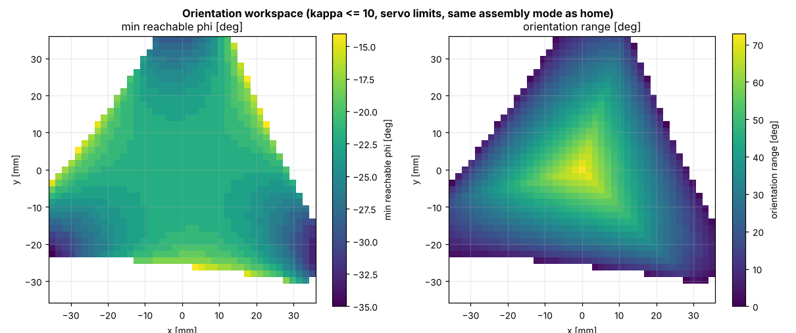

# 07 · Workspace analysis

A workspace is not just "where the platform can go". For a real job you need the region that is **reachable**, **inside the actuator travel**, **well conditioned** and in the **same assembly mode** as home. [`workspace.py`](../../ros2_ws/src/pm3rrr_core/pm3rrr_core/workspace.py) computes all of these by discretisation: test every grid point with the IK and the singularity measures.

## Constant-orientation workspace

For a fixed φ, test a grid of (x, y). A point is kept if all legs close and $|q_i| \le 85°$. Its colour is the condition number κ.


| φ | Reachable area | Largest well-conditioned circle (κ ≤ 5) around the centre |
|---|---|---|
| −15° | 34.4 cm² | **Ø 43 mm** |
| 0° | 21.7 cm² | **Ø 41 mm** |
| +15° | 10.9 cm² | **Ø 29 mm** |

The **datasheet number** of this robot: *"Ø 40 mm circular task space at constant orientation, ±15° rotation in the central region"*. The largest inscribed circle is what a customer can use without thinking about the shape.

Observations:

* The workspace is **triangular**, following the 3-fold symmetry. At φ = 0 its corners are cut by the servo travel limits.
* It is **not symmetric in φ**: −15° is larger than +15°. This comes from the +60° platform offset and the chosen working mode, so orientation capability depends on the design choices of lesson 02.

## Orientation workspace

For each (x, y): which φ range is usable (reachable, servo limits, κ ≤ 10, home assembly mode)?



In the centre the robot can rotate about **74°** in total (−22.5° … +51.5° at κ ≤ 10). Near the edges this drops to a few degrees. The lower limit of about −22° is the Type-II singularity of lesson 06.

## Working modes compared

`working_modes_summary()` compares the 8 modes (servo limits ignored, φ = 0):

| Modes | Reachable [cm²] | Well conditioned, κ ≤ 5 [cm²] |
|---|---|---|
| + + + | 21.6 | **19.4** |
| − − − (used) | 21.6 | **18.7** |
| mixed (6 modes) | 21.6 | 9.8 – 13.0 |

The symmetric modes are the useful ones. The project uses − − −, the original code's choice, which is also the best conditioned at home (κ = 1.15).

## How to choose the design (what a designer does with these maps)

| If you need... | Change | Effect |
|---|---|---|
| larger translations | longer links $l_1, l_2$ | larger area, lower stiffness and resolution |
| larger rotations | smaller $r_p$, or a different γ offset | larger φ range, worse orientation resolution |
| no internal singularities | restrict the task (S5 guard) or redesign (e.g. 4-RRR redundant actuation) | — |
| symmetric φ range | γ offset = 0° or 180° | different conditioning (exercise in lesson 02) |

## Try it

```python
import numpy as np
from pm3rrr_core import Pm3rrrKinematics
from pm3rrr_core.workspace import constant_orientation, largest_inscribed_circle
kin = Pm3rrrKinematics()
w = constant_orientation(kin, phi=0.0, half_size=0.05, n=121)
print(f"area {w.area*1e4:.1f} cm2, usable circle D = {2e3*largest_inscribed_circle(w, 5):.0f} mm")
```

## Exercises

1. Increase both link lengths to 60 mm (`RobotParams(l1=0.06, l2=0.06)`). How do the area and the usable circle change?
2. Plot the usable circle diameter as a function of φ from −25° to +25°.
3. Why are the areas of all 8 modes identical when servo limits are ignored? (Hint: when does a single leg close?)
