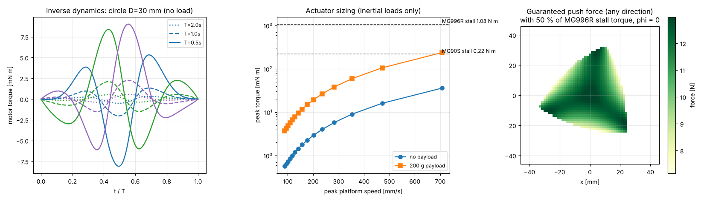

# 08 · Dynamics and actuator sizing

## Why dynamics?

To answer engineering questions: *Which motor? How fast can we go? What payload? What force can the tool apply?* For a parallel robot, the Lagrange equations of all bodies with loop constraints get messy. The **principle of virtual work** is the cleanest route, and it is what [`dynamics.py`](../../ros2_ws/src/pm3rrr_core/pm3rrr_core/dynamics.py) implements.

## Model

10 rigid bodies, each described by the planar velocity of its centre of mass and its angular velocity $\mathbf{v}_b = (v_x, v_y, \omega)$:

* 3 proximal links (mass, CoM and inertia from the CAD, lesson 03);
* 3 distal links;
* 1 platform (+ payload);
* 3 servo rotors (reflected rotor inertia, "armature").

Each body has a **body Jacobian** $\mathbf{v}_b = \mathbf{J}_b(\mathbf{x})\,\dot{\mathbf{x}}$, built from the kinematics:

* proximal: $\omega = \dot\theta_i$, $\mathbf{v} = \dot\theta_i\, s\,\mathbf{E}\mathbf{e}_1$
* distal: $\omega_i = \frac{(\mathbf{E}\mathbf{e}_2)\cdot(\dot C_i - \dot A_i)}{l_2}$, $\mathbf{v} = \dot A_i + s\,\omega_i\mathbf{E}\mathbf{e}_2$
* platform: $\mathbf{J}_b = \mathbf{1}$

## Inverse dynamics by virtual work

For any virtual motion $\delta\mathbf{x}$ (with $\delta\boldsymbol\theta = \mathbf{J}^{-1}\delta\mathbf{x}$), the work of the motor torques plus external forces equals the work of the inertial and gravity forces:

$$ \boldsymbol\tau^T\mathbf{J}^{-1}\delta\mathbf{x} + \mathbf{w}^T\delta\mathbf{x} = \sum_b \left(\mathbf{M}_b\mathbf{a}_b - \mathbf{f}_{g,b}\right)^T\mathbf{J}_b\,\delta\mathbf{x} $$

$$ \boxed{\ \boldsymbol\tau = \mathbf{J}^{-T}\left[\sum_b \mathbf{J}_b^T\left(\mathbf{M}_b\,\mathbf{a}_b - \mathbf{f}_{g,b}\right) - \mathbf{w}\right], \qquad \mathbf{a}_b = \mathbf{J}_b\ddot{\mathbf{x}} + \dot{\mathbf{J}}_b\dot{\mathbf{x}}\ } $$

with $\mathbf{M}_b = \mathrm{diag}(m, m, I_{zz})$. Planar rigid bodies have no Coriolis term in this form, so the result is exact. $\dot{\mathbf{J}}_b\dot{\mathbf{x}}$ is computed by a directional finite difference.

Task-space mass matrix: $\mathbf{M}_x = \sum_b \mathbf{J}_b^T\mathbf{M}_b\mathbf{J}_b$. At home it is $\approx 34\ \mathrm{g}$ effective mass in x and y.

**Validation (unit test):** the motor power $\boldsymbol\tau\cdot\dot{\boldsymbol\theta}$ must equal $\frac{d}{dt}(T + V)$ along any trajectory. The test passes to 0.2 % with and without gravity.

## Gravity: the robot is horizontal

The robot works in a horizontal plane, so gravity is **perpendicular to the motion**. It loads the bearings and the servo shafts in bending, but needs **no motor torque**. If you mount the robot on a wall, use `Pm3rrrDynamics(kin, gravity=(0, -9.81))`, and gravity becomes the dominant load.

## Results



1. **Left:** torques for a Ø30 mm circle. They scale with $1/T^2$: half the time, four times the torque.
2. **Middle, actuator sizing:** at 700 mm/s the inertial torques are only 0.036 N m without payload and 0.24 N m with a 200 g payload. The **MG996R** (1.08 N m) is oversized for inertia alone. What sizes the motor is (a) external process forces, (b) friction and backlash in a real build, (c) the **speed limit**: 7 rad/s no-load means about 350 mm/s of platform speed at best, and much less near the workspace edge.
3. **Right, force capability:** the force the platform can resist *in every direction* with 50 % of the stall torque. It is about **13.5 N** at home and drops towards the edges and near singularities: $\boldsymbol\tau = -\mathbf{J}^{-T}\mathbf{w}$, so $\mathbf{J}^{-T}$ blows up there.

### Sizing rule of thumb used in industry

$$ \tau_{required} = \text{SF}\cdot\left(\tau_{inertia} + \tau_{process} + \tau_{friction}\right) \le \tau_{continuous}, \qquad \text{SF} \approx 1.5\text{–}2 $$

Use the **continuous** torque (roughly 30–50 % of stall for hobby servos), never the stall torque.

## Try it

```python
from pm3rrr_core import Pm3rrrKinematics, Pm3rrrDynamics
from pm3rrr_core import trajectory as tr
kin = Pm3rrrKinematics(); dyn = Pm3rrrDynamics(kin)
traj = tr.sample(tr.circle((0, 0), 0.015), 0.5, 0.002)
tau = [dyn.inverse_dynamics(x, xd, xdd, wrench=(0.0, -2.0, 0.0)) for x, xd, xdd in zip(traj.x, traj.xd, traj.xdd)]
```

## Exercises

1. Add a 200 g payload on the platform by passing the payload's inertial force as `wrench=(-m*xdd[0], -m*xdd[1], 0)`. At which cycle time does the MG90S (0.22 N m stall) become insufficient with a safety factor of 2?
2. Mount the robot vertically (gravity −y). Plot the holding torques over the workspace. Where would you place a counterweight?
3. Derive $\mathbf{J}_b$ for the distal link yourself and compare with `body_jacobians()`.
