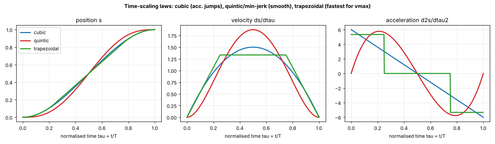
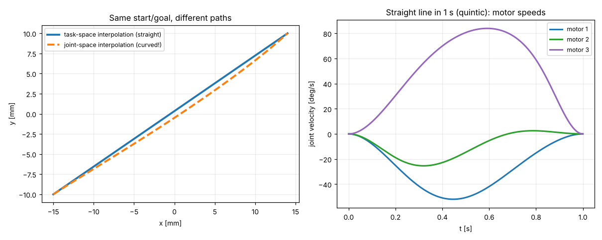

# 09 · Trajectory generation

A trajectory answers two separate questions, and keeping them separate is how industrial controllers work:

1. **Path**, *where*: $\mathbf{x}(s)$, $s\in[0,1]$, e.g. a line, an arc, a contour.
2. **Time scaling**, *how fast*: $s(t)$, which respects velocity and acceleration limits.

$$ \dot{\mathbf{x}} = \mathbf{x}'(s)\,\dot s, \qquad \ddot{\mathbf{x}} = \mathbf{x}''(s)\,\dot s^2 + \mathbf{x}'(s)\,\ddot s $$

## Time-scaling laws



| Law | $s(\tau)$, $\tau = t/T$ | Boundary conditions | Peak $\dot s$ | Peak $\ddot s$ | Use |
|---|---|---|---|---|---|
| Cubic | $3\tau^2 - 2\tau^3$ | $s, \dot s$ | 1.5 | 6 | simple, but the acceleration **jumps** at the start and end (jerk spikes, vibration) |
| Quintic = minimum jerk | $10\tau^3 - 15\tau^4 + 6\tau^5$ | $s, \dot s, \ddot s$ | 1.875 | 5.77 | smooth rest-to-rest moves (S2), human-like motion |
| Trapezoidal (LSPB) | parabolic blends + constant velocity | $s, \dot s$ | $1/(1-t_a)$ | $1/(t_a(1-t_a))$ | **constant speed** segment: dispensing, cutting (S3), time-optimal under $v_{max}$ |

Shortest duration for distance $D$ under limits $v_{max}, a_{max}$ (`min_duration`):

$$ T = \max\left(k_v \frac{D}{v_{max}},\ \sqrt{k_a\frac{D}{a_{max}}}\right) $$

where $k_v, k_a$ are the peak values in the table. A unit test checks the limits are respected.

## Paths

`trajectory.py` provides `line`, `circle`, `lemniscate` (figure-eight) and `point_to_point` (rest-to-rest through waypoints with dwell). Scenario S3 shows an **arc-length parameterised** contour: resample a polyline by distance so that constant $\dot s$ gives **constant speed**. This matters for bead width or cut quality.

## Task space or joint space?



* **Task-space interpolation** (straight line in x, y, φ, then IK at every sample): the tool follows the intended path. You must check every sample for reachability and singularities.
* **Joint-space interpolation** (interpolate $q$, then FK to see where the tool goes): the path **bends**, which is fine for free moves but wrong for processes.

Right panel: motor speeds for a 1 s straight move. Even this smooth task-space motion needs a non-trivial mix of motor speeds, and they grow without bound near singularities.

## From task space to joint space, with checks

```python
from pm3rrr_core import Pm3rrrKinematics, trajectory as tr
from pm3rrr_core.planning import guard_trajectory
kin = Pm3rrrKinematics()
traj = tr.point_to_point([(0, 0, 0), (0.009, 0.0045, 0), (0, 0, 0)], vmax=0.06, amax=0.6, dwell=0.5)
k_stop, why = guard_trajectory(kin, traj.x, kappa_max=10)       # singularity guard
q, qd, qdd, ok = tr.to_joint_space(kin, traj)                    # joint positions/velocities
assert ok.all() and abs(qd).max() < kin.p.servo.no_load_speed   # servo speed check
```

## Streaming vs. pre-planned

* **Pre-planned** (scenarios S2, S3, S5): the full trajectory is known, so it can be checked *before* moving. Industrial robots work this way.
* **Streaming** (S1 teleoperation, S4 stabilisation): targets arrive live. Use a **rate limiter** (max speed and acceleration per cycle) and an **online guard** that holds the last safe pose. `controller_node.py` and the firmware do exactly this.

## Exercises

1. Compute the peak jerk of the cubic and quintic laws for a 10 mm move in 0.3 s.
2. Implement a 7-segment (jerk-limited, "S-curve") profile and compare it with the quintic.
3. Re-run S3 with the cubic law instead of the trapezoid. What happens to the speed uniformity?
