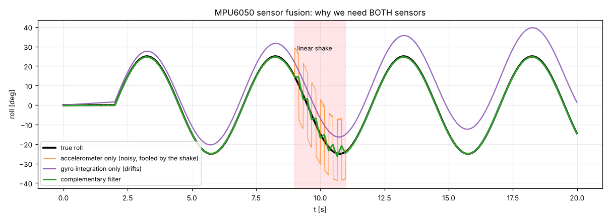

# 10 · IMU sensing and sensor fusion (MPU6050)

The project's original idea was to steer the platform by **tilting a hand-held MPU6050**. Making it work well requires understanding what the sensor really measures.

## What the MPU6050 measures

| Sensor | Measures | Raw scale (default range) | Problem |
|---|---|---|---|
| Accelerometer | specific force = gravity **plus** linear acceleration | 16384 LSB/g (±2 g) | noisy; fooled by any shake or hand acceleration |
| Gyroscope | angular **rate** | 131 LSB/(°/s) (±250 °/s) | bias (≈ ±1 °/s on a cheap part) → integrated angle **drifts** |

At rest, gravity gives the tilt:

$$ \text{roll} = \operatorname{atan2}(a_y, a_z), \qquad \text{pitch} = \operatorname{atan2}\!\left(-a_x, \sqrt{a_y^2 + a_z^2}\right) $$

The gyro gives the *change* of angle: $\theta(t) = \theta_0 + \int \omega\,dt$, accurate over short times but drifting over long times.

## The original approach and its problem

```cpp
dx = map(gyro_x, -32768, 32768, xi, xf);   // legacy/codes/parallel_inverse_kinematics
```

This maps the **rate** to a **position**. Holding the hand tilted (rate = 0) sends the platform back to the centre, and the gyro bias plus noise make it jitter. Integer `map()` adds 1 mm steps. Scenario S1 measured it: with the hand held at 25°, the original pipeline moves the platform by **0.5 mm**; at rest it jitters by **1.1 mm** (std).

## Complementary filter

Trust the gyro at high frequency and the accelerometer at low frequency:

$$ \hat\theta_k = \alpha\left(\hat\theta_{k-1} + (\omega_k - b)\,\Delta t\right) + (1-\alpha)\,\theta_{acc,k}, \qquad \alpha = \frac{\tau}{\tau + \Delta t} $$

* τ ≈ 0.3–0.5 s: below $1/(2\pi\tau)$ ≈ 0.4 Hz the accelerometer dominates (it corrects drift); above it the gyro dominates (it rejects shake).
* $b$ = gyro bias, **measured at power-up** with the sensor still (`calibrate()`, 1 s, 100–200 samples).



* Accelerometer only: correct on average, but noisy and badly wrong during the shake.
* Gyro only: smooth but drifting (≈ 15° after 18 s, from a 0.8 °/s bias).
* Complementary filter: follows the truth, rejects both problems. In S1 the RMS error is **0.29°**.

(Next steps used in products: a Kalman or Mahony/Madgwick filter that also estimates the bias online, or a sensor with on-chip fusion such as the BNO085 or ICM-42688 + DMP. See [industrialization/02](../industrialization/02_bill_of_materials.md).)

## From tilt to platform motion (`TiltTeleop`)

A usable human interface needs shaping:

1. **Dead band** (3°): a relaxed hand does not move the robot.
2. **Normalise** to the maximum tilt (25°).
3. **Expo curve** $y = (1-e)\,n + e\,n^3$: fine control near the centre, full reach at full tilt.
4. **Scale** to the reach (16 mm, inside the Ø41 mm usable circle).
5. **Rate limit** (50 mm/s), so the motion is smooth whatever the hand does.
6. **Reachability check**: never command an unreachable or singular pose.

The same chain runs in Python (`pm3rrr_core/imu.py`), in the ROS 2 node (`imu_teleop_node.py`) and on the Arduino (`teleopStep()` in the firmware).

## Practical MPU6050 tips

* Configure the **DLPF** (register 0x1A = 3, 44 Hz). It removes servo vibration before it reaches the filter.
* Use the PLL clock (0x6B = 1), not the internal 8 MHz oscillator.
* Two sensors on one I²C bus: AD0 low → 0x68 (hand), AD0 high → 0x69 (base or platform). The legacy sketch `servo_mpu6050.ino` already did this.
* Mount the sensor with known axes and verify them with `firmware/bringup/imu_check`: "nose down" must give positive pitch.
* Long I²C wires to a hand-held unit (> 30 cm) need stronger pull-ups (2.2 kΩ), 100 kHz, or a differential bus (see industrialization/03).

## Exercises

1. Derive the cut-off frequency of the complementary filter from α.
2. Set the bias calibration to zero and re-run `fig_imu`. How fast does the gyro-only estimate drift, and how much of that leaks into the filter output?
3. Why can't yaw be estimated this way? Which sensor would you add? (Scenario S4 integrates the gyro z and accepts a slow drift.)
