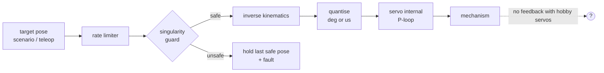
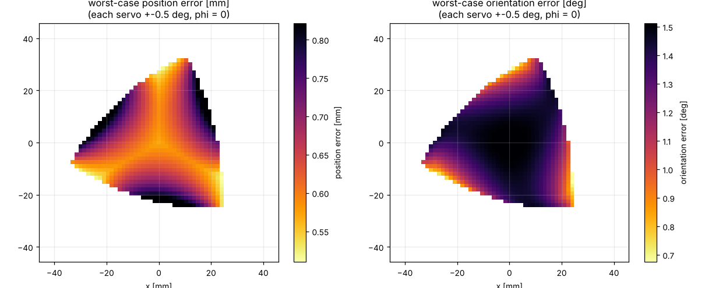

# 11 · Actuators, accuracy and control

## The control architecture

The robot uses **hobby servos**: each one contains a DC motor, a gearbox, a potentiometer and a small analogue/digital P-controller. We send a *position* and the servo closes its own loop. That is simple, but the controller **does not know** where the robot really is. Everything the PC/Arduino does is feed-forward.

## A behavioural servo model (what the simulations use)

[`servo.py`](../../ros2_ws/src/pm3rrr_core/pm3rrr_core/servo.py) models what matters for accuracy:

| Effect | MG996R value | Consequence |
|---|---|---|
| Command quantisation | `write(int)`: 1° · `writeMicroseconds`: ≈ 0.18° | resolution floor |
| **Dead band** | ≈ 0.5° (≈ 5 µs) | the servo stops anywhere within ±0.5° of the command → **dominant error** |
| Speed limit | 7 rad/s no load (0.14 s/60° at 6 V) | limits fast moves; lag at high speed |
| Internal lag | τ ≈ 40 ms | tracking error proportional to speed |

In the physics simulation, the model's output drives a MuJoCo PD actuator limited to the stall torque (1.08 N m). This is the "servo internal P-loop" of the diagram.

## Accuracy: from joint errors to platform errors

With the forward Jacobian $\mathbf{J}$: $\delta\mathbf{x} = \mathbf{J}\,\delta\boldsymbol\theta$. The worst case for a joint error box $|\delta\theta_i| \le \epsilon$ is at a corner of the box:

For ε = 0.5° (the dead band), at φ = 0:

* **position:** 0.55–0.8 mm across the workspace (0.57 mm at home);
* **orientation:** 0.7–1.5° (1.53° at home). Orientation is the weak spot because $\partial\varphi/\partial\theta_i = 1.02$ for every motor, so the three errors add up.

The simulations confirm it:

| Actuator option | Mean stop error (S2) | Comment |
|---|---|---|
| hobby servo, `write(int deg)` (original) | 0.66 mm | 1° quantisation **and** dead band |
| hobby servo, `writeMicroseconds` (new firmware) | 0.56 mm | dead band remains |
| smart servo (12-bit encoder, 0.088°, small dead band) | **0.06 mm** | 10× better: the industrial upgrade |

**Conclusion:** better maths cannot beat the actuator. For precision work, use actuators with real position feedback: smart servos (Dynamixel XL430/XM430, Feetech STS3215) or BLDC/stepper motors with encoders and a proper servo drive.

## Control options, from simple to industrial

| Level | What | Gain | Where |
|---|---|---|---|
| 0 | open-loop hobby servos, IK feed-forward | — | original project |
| 1 | + rate limiting, guard, µs commands, calibration (trims, link lengths) | safe, repeatable | **this repo's firmware** |
| 2 | smart servos with position/current feedback; read back the joint positions → FK → measured pose | accuracy, fault detection | [industrialization/02](../industrialization/02_bill_of_materials.md) |
| 3 | dynamic feed-forward $\boldsymbol\tau_{ff}$ from lesson 08 + joint PD (computed torque) | high-speed tracking | ros2_control effort interface |
| 4 | external sensing of the platform (camera, the platform IMU in the URDF) → task-space correction | removes the residual kinematic errors | research / high-end |

### The servo loop in Gazebo

`ros2_control` drives the motors through an **effort** interface with PD gains (`pm3rrr_gazebo/config/controllers.yaml`, p = 2.0 N m/rad, d = 0.03 N m s/rad). Rule of thumb: with total motor-side inertia $I$, the closed-loop natural frequency is $\omega_n = \sqrt{p/I}$. Keep $\omega_n\Delta t \ll 1$ for the physics step Δt (1 ms in Gazebo) and choose $d \approx 2\zeta\sqrt{pI}$ with ζ ≈ 0.7–1.

### Base-motion compensation (S4)

An example of **feed-forward from a sensor**: a gyro on the base measures the yaw ψ, and the controller commands $\mathbf{x}_{base} = \mathbf{R}(-\hat\psi)\,\mathbf{x}_{world}$, $\varphi_{base} = \varphi_{world} - \hat\psi$. A small **prediction** $\hat\psi + \dot{\hat\psi}\,T_{lag}$ cancels the servo lag. Result: world-frame position error 0.85 → 0.20 mm and orientation error 6.8° → 1.0°.

## Exercises

1. In S2, set the dead band to 0 in `ServoSpec`. What error is left, and where does it come from?
2. Add the lag-prediction term to S1's teleoperation. Does the tracking error decrease?
3. Using the accuracy map, specify the dead band a servo needs for ±0.1 mm positioning.
