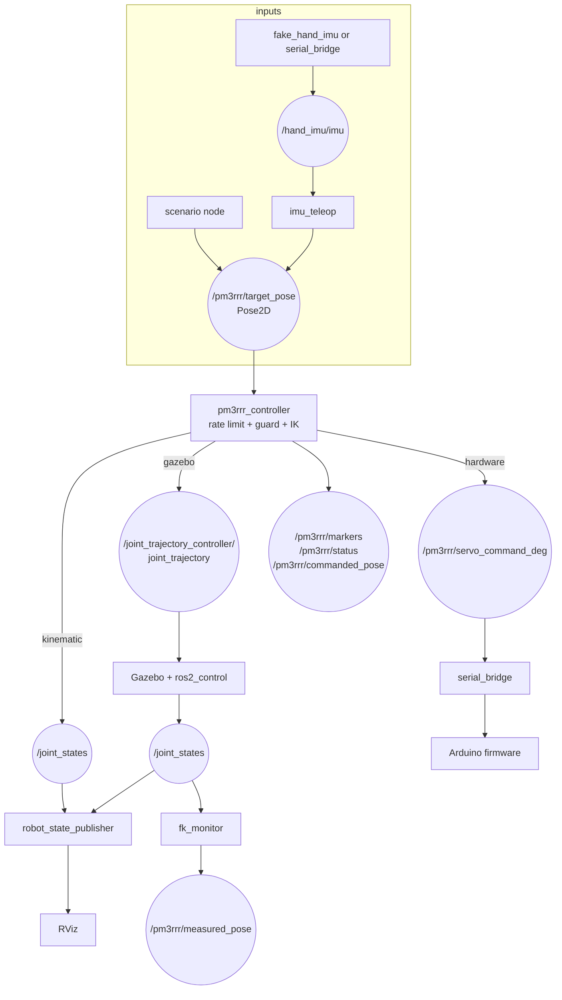

# 12 · ROS 2 Humble architecture: RViz, Gazebo and hardware

## Packages

| Package | Type | Contents |
|---|---|---|
| `pm3rrr_core` | ament_python, **no ROS imports** | kinematics, dynamics, workspace, trajectories, IMU, planning (also pip-usable) |
| `pm3rrr_description` | ament_cmake | URDF/xacro, meshes, SRDF, `robot_params.yaml`, `inertials.yaml`, RViz config |
| `pm3rrr_control` | ament_python | nodes: `controller`, `scenario`, `imu_teleop`, `fake_hand_imu`, `fk_monitor`, `serial_bridge` |
| `pm3rrr_gazebo` | ament_cmake | world, `controllers.yaml`, `gazebo.launch.py` |
| `pm3rrr_bringup` | ament_cmake | `sim_rviz`, `sim_gazebo`, `hardware` launch files |

Keeping the maths ROS-free makes it testable without ROS, reusable in the desktop simulation and the analysis scripts, and easy to port (the firmware mirrors it in C++).

## Three ways to run, same controller



| Mode | Command | Physics | Use |
|---|---|---|---|
| **kinematic** | `ros2 launch pm3rrr_bringup sim_rviz.launch.py scenario:=figure8` | none (IK → joint states) | learning, trajectory checks, demos on any laptop |
| **gazebo** | `ros2 launch pm3rrr_bringup sim_gazebo.launch.py scenario:=microplate` | Gazebo Classic 11 / ODE with closed loops, effort-controlled motors, platform IMU | controller tuning, dynamics |
| **hardware** | `ros2 launch pm3rrr_bringup hardware.launch.py port:=/dev/ttyUSB0 scenario:=imu` | real robot | the product |

Scenarios: `figure8`, `microplate` (S2), `contour` (S3), `rotation_limit` (S5, watch the guard stop it), `imu` (S1, simulated or real hand IMU), `none` (publish your own targets).

```bash
ros2 topic pub -1 /pm3rrr/target_pose geometry_msgs/msg/Pose2D "{x: 0.010, y: -0.005, theta: 0.1}"
ros2 topic echo /pm3rrr/status
```

## Interfaces

| Topic | Type | Direction | Notes |
|---|---|---|---|
| `/pm3rrr/target_pose` | `geometry_msgs/Pose2D` | → controller | m, m, rad; streaming |
| `/joint_states` | `sensor_msgs/JointState` | controller or Gazebo → RSP | 7 tree joints; 0 = home |
| `/joint_trajectory_controller/joint_trajectory` | `trajectory_msgs/JointTrajectory` | controller → ros2_control | 1-point stream, 60 ms look-ahead |
| `/pm3rrr/servo_command_deg` | `std_msgs/Float64MultiArray` | controller → bridge | 0–180°, 90 = centre |
| `/hand_imu/imu` | `sensor_msgs/Imu` | bridge/fake → teleop | raw accel + gyro, no orientation |
| `/pm3rrr/commanded_pose`, `/pm3rrr/measured_pose` | `geometry_msgs/PoseStamped` | diagnostics | measured = FK of `/joint_states` |
| `/pm3rrr/status` | `std_msgs/String` | diagnostics | κ and fault text, 2 Hz |
| `/pm3rrr/markers` | `visualization_msgs/MarkerArray` | RViz | usable workspace outline, trail, target |
| `/platform/imu` | `sensor_msgs/Imu` | Gazebo | MPU6050-like noise, on `imu_link` |

## Why Gazebo **Classic** for Humble?

Humble officially pairs with Gazebo Classic 11 (`gazebo_ros_pkgs`, `gazebo_ros2_control`) and with Ignition/Gazebo Fortress. This robot is a **closed kinematic chain**. Gazebo Classic's ODE solves loop-closure joints robustly. Fortress's default DART and Bullet-Featherstone back-ends do not support kinematic loops well. Classic is end-of-life upstream but remains the practical Humble choice for closed chains. To move to modern Gazebo (Harmonic, with ROS 2 Jazzy), port the `<gazebo>` loop joints to SDF and test them carefully. The MuJoCo model in `simulation/` is an independent, modern physics check of the same URDF.

## MoveIt?

The SRDF exists (groups, passive joints, collision matrix, `home` state), but MoveIt's planners assume serial chains. The recommended pattern for parallel robots: MoveIt (or any planner) decides *where*, `pm3rrr_core` provides analytic IK and singularity checking, and the controller executes. A full MoveIt integration would need a custom kinematics plugin wrapping `Pm3rrrKinematics.ik`. That is a good student project.

## Next step for industry: a ros2_control hardware interface

The serial bridge is simple and transparent, which suits teaching. A product should implement a `hardware_interface::SystemInterface` (C++) that talks to the firmware or to smart servos directly. The same controllers then run in Gazebo and on hardware, with read-back positions. See [industrialization/04](../industrialization/04_firmware_and_protocol.md).

## Build and test

```bash
cd ros2_ws
rosdep install --from-paths src -y --ignore-src
colcon build --symlink-install
source install/setup.bash
colcon test && colcon test-result --verbose
```

## Exercises

1. Write a node that publishes a target from the keyboard (arrow keys move 1 mm, `q`/`e` rotate 1°).
2. In Gazebo, plot `/pm3rrr/tracking_error` with `rqt_plot` while running the microplate scenario. Tune the PD gains.
3. Add the platform IMU (`/platform/imu`) to `fk_monitor` and compare its yaw rate with the FK-derived rate.
