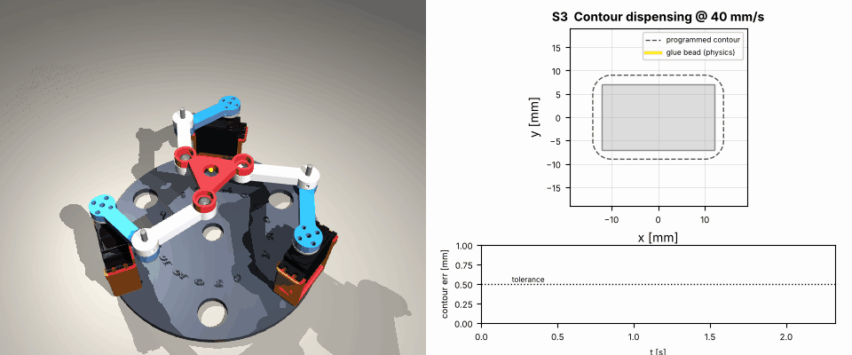
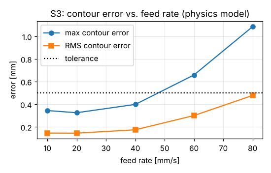

# S3 · Contour following: dispensing a glue bead



## Problem

Dispense adhesive around a **28 × 18 mm part** (rounded corners, r = 4 mm, perimeter 85 mm). The bead must follow the contour within **±0.5 mm** (half of a 1 mm bead width) at a **constant speed** (the bead width depends on speed). What feed rate can we run? The same problem appears in laser engraving, cutting and seam inspection.

## Setup

* Arc-length parameterised contour, **trapezoidal** time scaling (8 % ramps) → constant speed on the contour.
* Feed-rate sweep: 10, 20, 40, 60, 80 mm/s, physics + hobby servos (`writeMicroseconds`).
* Contour error = distance from the actual tool point to the nearest point of the programmed contour.

## Results

| Feed [mm/s] | Cycle [s] | RMS error [mm] | Max error [mm] | Speed ripple | ±0.5 mm? |
|---|---|---|---|---|---|
| 10 | 9.26 | 0.146 | 0.345 | 10.8 % | yes |
| 20 | 4.63 | 0.145 | 0.325 | 3.6 % | yes |
| **40** | **2.32** | 0.175 | 0.399 | 3.0 % | **yes** |
| 60 | 1.55 | 0.300 | 0.659 | 4.1 % | no |
| 80 | 1.16 | 0.478 | 1.085 | 5.5 % | no |



**Choose 40 mm/s.** Below that, the error floor (≈0.15 mm RMS) comes from the servo dead band. Above it, the servo lag (40 ms) cuts the corners.

## Lessons

1. Process quality needs **constant speed**: arc-length parameterisation plus a trapezoidal profile.
2. An error-vs-speed curve is how a process engineer picks the feed rate. You can compute it *before* building anything.
3. To go faster: add velocity feed-forward (or the lag prediction of S4), or use servos with a faster loop.

## Run it

```bash
python3 simulation/scenarios/s3_contour_dispensing.py
ros2 launch pm3rrr_bringup sim_rviz.launch.py scenario:=contour
```
