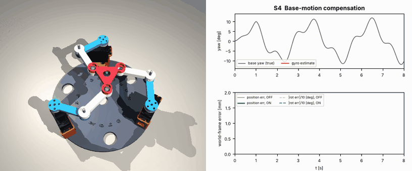

# S4 · Stabilising a tool while the base moves



*(The camera is world-fixed. The base rotates underneath; the green dot is the world-fixed target.)*

## Problem

The robot sits on something that **rotates**: a vehicle, a ship deck, a turntable, a hand-held tool. A sensor, laser or camera on the platform must stay on a **world-fixed** target (6 mm, 4 mm). An MPU6050 on the base measures the yaw rate.

## Setup

* Base yaw: $9°\sin(2\pi\,0.35t) + 3°\sin(2\pi\,1.1t+0.5)$, up to ±12°.
* Base gyro: bias 1.2 °/s (calibrated at power-up), noise, 200 Hz.
* Estimator: $\hat\psi = \int(\omega_z - b)\,dt$, plus lag prediction $\hat\psi + \dot{\hat\psi}\,T_{lag}$ ($T_{lag}$ = 45 ms).
* Command in the base frame: $\mathbf{p}_{base} = \mathbf{R}(-\hat\psi)\,\mathbf{p}_{world}$, $\varphi_{base} = \varphi_{world} - \hat\psi$.

## Results

| | World position error RMS (max) | Orientation error RMS |
|---|---|---|
| compensation OFF | 0.85 mm (1.51 mm) | 6.78° |
| **compensation ON** | **0.20 mm (0.40 mm)** | **0.98°** |

Yaw-estimate drift after 8 s: 0.03° (thanks to the bias calibration).

## Lessons

1. Feed-forward from a sensor (here the gyro) can cancel a measured disturbance before it shows up at the tool.
2. **Latency matters**: the residual error mostly comes from the servo lag. The simple prediction term removes a large part of it.
3. A gyro alone cannot hold yaw forever (drift). For long missions, add an absolute reference (magnetometer, vision, encoder on a turntable) and fuse it (lesson 10).
4. Translations of the base could be compensated the same way, but double-integrating an accelerometer drifts quickly, so they need an absolute position sensor.

## Run it

```bash
python3 simulation/scenarios/s4_base_motion_compensation.py
```
